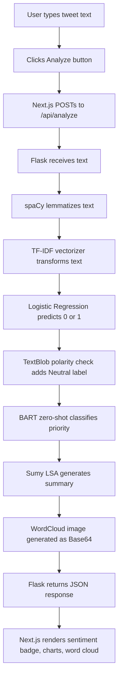
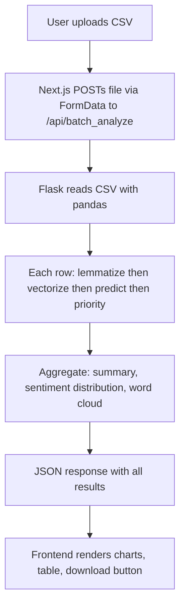

# TweetSense — Project Understanding & Interview Dossier

> **Purpose:** Interview preparation. Read this before your interview. Do not read it like a textbook — scan it.

---

## 0. Project in 60 Seconds

| | |
|---|---|
| **Problem** | Manually reading large volumes of tweets to understand public sentiment is slow and subjective |
| **Solution** | A web app that takes tweet text and returns its sentiment (Positive / Negative / Neutral), plus supporting analysis |
| **Users** | Students, researchers, anyone who wants quick sentiment insight from social media text |
| **Core idea** | Train a Logistic Regression model on 1.6M tweets, expose it via a Flask REST API, consume it from a Next.js frontend |
| **Tech stack** | Next.js (frontend) → Flask (backend API) → Logistic Regression + TF-IDF (ML) → Hugging Face Transformers (zero-shot priority) → spaCy (preprocessing) |
| **Architecture** | User → Next.js UI → Flask REST API → ML Model → JSON response → UI renders results |
| **Mode** | Single tweet analysis + Batch CSV analysis |

---

## 1. Problem & Motivation

Twitter/X is a real-time signal of public opinion. Companies, researchers, and analysts want to know:

- Is the conversation about a product/event positive or negative?
- Which comments need immediate attention (high priority)?
- What are the dominant topics in a large set of tweets?

Doing this manually does not scale. This project demonstrates using classical ML + modern NLP utilities to automate that pipeline.

This is described in the footer as a **final-year mini-project** to showcase NLP skills. 🟢 Verified

---

## 2. What the System Does

Two main modes:

**Single Tweet Analysis**
- User types or pastes any text
- System returns: sentiment label, confidence score, priority classification, word count, text summary, word cloud image

**Batch CSV Analysis**
- User uploads a CSV with a `text` column
- System processes all rows and returns: per-row sentiment + confidence + priority, overall summary, sentiment distribution charts, priority distribution chart, combined word cloud, downloadable results CSV

The system does NOT connect to the live Twitter API — it analyzes text you provide to it. 🟢 Verified (no active Twitter/X API calls in the production Flask backend; `scrape_tweets` using Selenium exists in `app2.py` but is not wired to any API endpoint)

🟡 Inferred: `app2.py` is a legacy/Streamlit prototype; `analysis_backend.py` is the current production backend.

---

## 3. User Journey

### Single Tweet



### Batch CSV



---

## 4. High-Level Architecture

```
User (Browser)
    |
    | HTTP localhost:3000
    v
Frontend — Next.js 15
(SentimentHomePage.tsx — single page, all state in React)
    |
    | REST API calls localhost:5000
    v
Backend — Flask
/api/analyze          /api/batch_analyze
    |
    +--------+--------------------+
    |        |                    |
    v        v                    v
 spaCy    ML Models           NLP Utilities
(lemma)  TF-IDF Vectorizer    TextBlob (polarity)
         LogisticRegression   BART (zero-shot priority)
         (loaded from .sav)   Sumy LSA (summary)
                              WordCloud (image)
```

Layer summary:
- **Frontend** — Single Next.js page, all UI state in React. No database, no auth.
- **Flask backend** — Stateless API. Loads ML models once at startup, serves every request.
- **ML layer** — Pre-trained Logistic Regression + TF-IDF. Loaded from `.sav` files (joblib).
- **NLP utilities** — spaCy for preprocessing, TextBlob for polarity, Sumy for summaries, WordCloud for visuals, Hugging Face BART for zero-shot priority.

---

## 5. End-to-End System Flow (Single Tweet)

1. User enters text in the input box and clicks **Analyze**.
2. Frontend validates length (>=5 characters), then POSTs `{ "text": "..." }` to `http://localhost:5000/api/analyze`.
3. Flask receives the JSON body.
4. `preprocess_text()` runs spaCy on the text → extracts lemmas → returns cleaned string.
5. `vectorizer.transform([processed])` converts the string to a TF-IDF sparse vector.
6. `model.predict(X)` returns `0` (Negative) or `1` (Positive).
7. `model.predict_proba(X)` returns probabilities → `max()` is the confidence score.
8. `get_sentiment_label()` checks TextBlob polarity. If −0.1 <= polarity <= 0.1 → **Neutral** (overrides model prediction).
9. `prioritize_comment()` calls `facebook/bart-large-mnli` zero-shot with labels `["High Priority", "Medium Priority", "Low Priority"]` → returns top label.
10. `get_summary()` runs Sumy LSA on the raw text → returns 2-sentence summary.
11. `generate_wordcloud()` creates a word cloud PNG → Base64-encodes it as a data URL.
12. Flask returns a single JSON object with all results.
13. React state updates → UI renders sentiment badge, confidence pie chart, priority card, summary, word cloud.

---

## 6. Technology Stack

| Layer | Technology | How it is used |
|---|---|---|
| Frontend | Next.js 15 (React 19, TypeScript) | Single-page UI, handles API calls, renders all results |
| Styling | Tailwind CSS v4 | Utility classes throughout SentimentHomePage.tsx |
| Charts | Recharts | Pie chart (confidence/sentiment), bar chart (priority distribution) |
| Icons | Lucide React | All UI icons |
| Backend | Flask (Python) | REST API exposing /api/analyze and /api/batch_analyze |
| CORS | flask-cors | Allows Next.js (port 3000) to call Flask (port 5000) |
| ML Model | Logistic Regression (scikit-learn) | Core sentiment classifier, binary (0/1) |
| Vectorizer | TF-IDF (scikit-learn) | Converts text to numerical feature vectors |
| Model storage | joblib | Saves/loads trained model and vectorizer as .sav files |
| Preprocessing | spaCy en_core_web_sm | Lemmatization at inference time |
| Polarity | TextBlob | Adds Neutral label when polarity is near zero |
| Priority | Hugging Face facebook/bart-large-mnli | Zero-shot classification for priority levels |
| Summarization | Sumy (LSA algorithm) | Extractive text summarization |
| Visualization | WordCloud (Python) | Generates word cloud PNG returned as Base64 |
| Training data | Sentiment140 (1.6M tweets) | Dataset used to train the LR model |
| Notebook | Jupyter (proj.ipynb) | Training, preprocessing, evaluation, and export |

---

## 7. Why the Major Technologies?

### Logistic Regression

**What it does here:** Classifies tweet text as Positive (1) or Negative (0).

**Why it was used:** Fast to train, interpretable, works well with TF-IDF sparse vectors. Achieved ~79.8% test accuracy and 0.804 F1-score. 🟢 Verified from notebook outputs.

**Where it appears:** `trained_model.sav` (loaded in `analysis_backend.py`), trained in `proj.ipynb`.

**Alternative:** SVM, BERT/transformer-based model.

**Why not BERT:** BERT requires GPU at inference, significantly higher latency, and much more complex deployment — overkill for a mini-project demonstrating the concept.

---

### TF-IDF Vectorizer

**What it does here:** Converts lemmatized tweet text into a numerical sparse matrix that Logistic Regression understands.

**Why it was used:** Standard and effective for classical text classification. Vocabulary learned from all 1.6M training tweets.

**Where it appears:** `vectorizer.sav` (loaded at Flask startup), `vectorizer.transform()` called at each inference request.

**Alternative:** Word2Vec embeddings, BERT embeddings.

---

### Flask

**What it does here:** Exposes the ML models as a REST API. Next.js calls these endpoints.

**Why it was used:** Lightweight Python web framework. Trivial to wrap a scikit-learn model into HTTP endpoints. Matches the Python ML ecosystem.

**Where it appears:** `analysis_backend.py` — two routes: `/api/analyze` (POST, JSON body) and `/api/batch_analyze` (POST, multipart CSV file).

**Alternative:** FastAPI (async + auto-docs), Django (heavier, unnecessary here).

---

### Next.js / React

**What it does here:** Provides the entire user interface as a single-page application.

**Why it was used:** Modern React framework with TypeScript, good developer experience, built-in routing. Functions as a pure client-side app talking to Flask.

**Where it appears:** `frontend/` directory, single component `SentimentHomePage.tsx`.

---

### Hugging Face BART (Zero-Shot Classification)

**What it does here:** Classifies each tweet into High Priority, Medium Priority, or Low Priority without task-specific training.

**Why it was used:** No labeled training data for "priority levels." Zero-shot classification uses the model's language understanding to classify into arbitrary categories at inference time.

**Where it appears:** `prioritize_comment()` in `analysis_backend.py`. Uses `facebook/bart-large-mnli`.

**Trade-off:** Slowest part of each request — large model, significant latency on CPU. 🟡 Inferred

---

### spaCy

**What it does here:** Lemmatizes text at inference time to match training-time preprocessing.

**Why it was used:** The model was trained on lemmatized text. Inference must apply the same transformation. spaCy is fast and accurate.

**Important:** During training, Porter Stemming was explored first (notebook cell 19), then switched to spaCy lemmatization (cell 22). The final saved model uses lemmatized input. 🟢 Verified from notebook.

---

## 8. Core Components

### analysis_backend.py — Production Flask API
- **Responsibility:** Loads ML models at startup, exposes two REST endpoints, orchestrates all NLP steps
- **Input:** JSON `{ text }` or multipart CSV file
- **Output:** JSON with sentiment, confidence, priority, summary, word cloud (Base64)
- **Pipeline:** preprocess → vectorize → predict → TextBlob neutral check → BART priority → Sumy summary → WordCloud

### SentimentHomePage.tsx — Entire Frontend (959 lines)
- **Responsibility:** All UI: hero, search input, batch upload, results display, charts, download
- **Input:** User text or uploaded CSV
- **Output:** Sentiment badge, pie chart, bar chart, word cloud, results table, CSV download
- **Key logic:** Two async handlers (handleAnalysis, handleBatchAnalysis), React state, Recharts rendering

### proj.ipynb — Training Pipeline
- **Responsibility:** Data loading, preprocessing, model training, evaluation, model export
- **Input:** training.1600000.processed.noemoticon.csv (Sentiment140)
- **Output:** trained_model.sav, vectorizer.sav, twitter_data_lemmatized.csv

### app2.py — Legacy Streamlit Prototype
- **Status:** 🟡 Inferred to be a development artifact, superseded by Flask + Next.js
- **Notable extra:** Contains `scrape_tweets()` using Selenium — not connected to any API endpoint in the production version

---

## 9. Data Flow

### Training Pipeline

```
Sentiment140 CSV (1.6M tweets)
    → pandas read_csv
Raw tweet text + binary label (0=negative, 4=positive → mapped to 1)
    → spaCy lemmatization
Lemmatized text
    → TF-IDF fit_transform (learns vocabulary from all 1.6M tweets)
Sparse TF-IDF matrix
    → LogisticRegression.fit (max_iter=1000)
Trained model
    → joblib.dump
trained_model.sav + vectorizer.sav
```

### Inference Pipeline (per request)

```
Raw user text (string)
    → spaCy lemmatize
Lemmatized string
    → vectorizer.transform (same vocab from training)
TF-IDF sparse vector
    → model.predict + model.predict_proba
Prediction (0/1) + confidence (float)
    → TextBlob polarity check
Sentiment label: Positive / Negative / Neutral
    → BART zero-shot
Priority label: High / Medium / Low Priority
    → Sumy LSA
Text summary (2–3 sentences)
    → WordCloud library
Word cloud PNG → Base64 string
    → Single JSON response → Frontend
```

---

## 10. Data Storage

There is **no database** in this project. 🟢 Verified

| Data | Where it lives |
|---|---|
| Trained model | backend/trained_model.sav (~5.4 MB joblib file) |
| Trained vectorizer | backend/vectorizer.sav (~16.5 MB joblib file) |
| Raw training data | backend/training.1600000.processed.noemoticon.csv (~228 MB) |
| Lemmatized training data | backend/twitter_data_lemmatized.csv (~328 MB) |
| User data | React state only — never persisted |
| Batch results | Downloaded as CSV client-side — never stored server-side |

The `.sav` files are loaded once at Flask startup into memory and reused for every request.

---

## 11. Important Implementation Details

### The Neutral Label Trick
The Sentiment140 dataset is binary. To produce three-class output, the system uses TextBlob polarity. If polarity is between −0.1 and 0.1, the model prediction is overridden with **Neutral**. This avoids needing labeled neutral training data. It is a heuristic — the threshold is not validated with ground truth neutral data.

### Word Cloud as Base64
Flask generates the PNG in-memory (BytesIO), Base64-encodes it, and returns it as a `data:image/png;base64,...` string in JSON. The frontend renders it in an `` tag. No file I/O needed.

### CORS
`flask-cors` with `CORS(app)` allows the Next.js frontend (port 3000) to call the Flask API (port 5000). Without this, the browser same-origin policy would block requests.

### Two Backends
- `app2.py` — Streamlit standalone app (legacy). Contains Selenium scraping, Pegasus summarizer, Tweepy import.
- `analysis_backend.py` — Flask REST API (current). Cleaner, no Selenium, uses Sumy (extractive) instead of Pegasus (abstractive).

### Models Loaded at Startup
`vectorizer.sav` (16 MB) and `trained_model.sav` (5 MB) are loaded once when Flask starts. No per-request disk I/O — fast inference.

---

## 12. Key Files & Responsibilities

```
TweetSense/
├── backend/
│   ├── analysis_backend.py   ← Production Flask API (current)
│   ├── app2.py               ← Legacy Streamlit prototype
│   ├── proj.ipynb            ← Training notebook
│   ├── trained_model.sav     ← Serialized LogisticRegression (5.4 MB)
│   └── vectorizer.sav        ← Serialized TF-IDF Vectorizer (16.5 MB)
│
└── frontend/
    ├── app/
    │   ├── layout.tsx         ← Root layout, Google Fonts (Geist)
    │   └── page.tsx           ← Entry point, renders SentimentHomePage
    └── components/
        └── SentimentHomePage.tsx  ← Entire frontend (959 lines)
```

---

## 13. Major Engineering Decisions

| Decision | Reason | Trade-off |
|---|---|---|
| Logistic Regression over deep learning | Fast, no GPU needed, good accuracy with TF-IDF | Less accurate than BERT on nuanced/sarcastic text |
| TF-IDF over word embeddings | Sparse, efficient, well-matched to LR | Loses word order and semantic meaning |
| spaCy lemmatization over Porter Stemming | More linguistically accurate; final model trained on lemmas | Slightly slower than stemming |
| Sumy LSA over Pegasus for summary | Extractive, no large model download needed, faster at runtime | Less abstractive quality than Pegasus |
| Zero-shot BART for priority | No labeled priority dataset available | Slow; lower accuracy than a fine-tuned model |
| Flask + Next.js over Streamlit | Cleaner separation of concerns, proper REST API, modern UI | Two servers to run; more setup |
| Models loaded at startup | Avoids reload latency per request | Slow startup; not serverless-friendly |

---

## 14. Challenges & Solutions

**Challenge 1 — Neutral Classification Without Three-Class Training Data**

Problem: Sentiment140 is binary. Real tweets can be neutral.

Solution: TextBlob polarity score as post-processing filter. If polarity is near zero (−0.1 to 0.1), override binary prediction with "Neutral."

Result: Three-class output without collecting neutral training data. The boundary threshold is a heuristic. 🟡 Inferred accuracy.

---

**Challenge 2 — Preprocessing Consistency Between Training and Inference**

Problem: Model trained on lemmatized text — different preprocessing at inference degrades predictions.

Solution: Both training (proj.ipynb) and inference (analysis_backend.py) use identical spaCy pipeline.

Result: Consistent feature space. Model sees same representation at inference as during training.

---

**Challenge 3 — CORS Between Frontend and Backend**

Problem: Browser blocks cross-origin requests (Next.js port 3000 → Flask port 5000).

Solution: flask-cors applied with CORS(app). Fine for local demo; permissive setting not suitable for production.

---

**Challenge 4 — Returning Image Data in JSON**

Problem: REST API returns JSON, not binary files.

Solution: Generate PNG in-memory, Base64-encode, return as string in JSON. Frontend renders as ``.

---

## 15. Error Handling / Edge Cases

| Scenario | Handling |
|---|---|
| Text too short (<5 chars) | Frontend blocks request, shows inline error |
| Empty text field | Backend returns 400: "No text provided" |
| CSV missing text column | Backend returns 400 with descriptive message |
| Invalid file type | Frontend validates extension before upload |
| Flask not running | Frontend catches fetch error, shows port hint message |
| spaCy model not loaded | preprocess_text falls back to raw text |
| BART model load failure | prioritize_comment returns "N/A" gracefully |
| Word cloud failure | Returns None; frontend shows fallback text |

---

## 16. Security / Performance / Scalability

**Security**
- No authentication — demo project 🟢 Verified
- CORS(app) open to all origins — not production-safe 🟢 Verified
- No input sanitization beyond length check
- No rate limiting

**Performance**
- TF-IDF + LR inference: fast (milliseconds per request) 🟡 Inferred
- BART zero-shot: slowest step — large model on CPU 🟡 Inferred
- .sav files in memory — no per-request I/O 🟢 Verified
- Batch: sequential Python for-loop — no parallelism 🟢 Verified

**Scalability**
- Single-process Flask — not horizontally scalable
- No caching
- Designed for local demo use only

---

## 17. My Personal Contribution

🔴 **Cannot be determined from code alone — requires your confirmation.**

**What the repository contains overall:**
- `proj.ipynb` — training pipeline (data loading, preprocessing, model training, evaluation, export)
- `analysis_backend.py` — Flask API (two endpoints, all NLP utilities integrated)
- `app2.py` — Streamlit prototype (Selenium scraping, Pegasus summarizer)
- `SentimentHomePage.tsx` — full UI (single + batch analysis, charts, download)

**What you should confirm:**
- Did you write the training notebook?
- Did you write the Flask API?
- Did you write the Next.js frontend?
- Did you write the Streamlit prototype?
- Solo project or team project?

**Third-party components:**
- Sentiment140 dataset (Stanford)
- scikit-learn, spaCy, TextBlob, Sumy, WordCloud, Transformers (open-source)
- facebook/bart-large-mnli (Meta AI via Hugging Face)
- Next.js, React, Recharts, Tailwind, Lucide (open-source)

---

## 18. Current Limitations

| Limitation | Type |
|---|---|
| Neutral is a heuristic (TextBlob), not a trained class | 🟢 Verified |
| No live Twitter API integration — user must paste text manually | 🟢 Verified |
| BART zero-shot is slow on CPU | 🟡 Inferred |
| Batch analysis is sequential, not parallelized | 🟢 Verified |
| No persistence — no history, no database | 🟢 Verified |
| No authentication or rate limiting | 🟢 Verified |
| CORS(app) is open — not production-safe | 🟢 Verified |
| Model trained on 2009 tweets — may not reflect modern slang/emojis | 🟡 Inferred |
| Single-process Flask — not horizontally scalable | 🟢 Verified |

---

## 19. Possible Improvements

1. Fine-tune a lightweight priority classifier instead of zero-shot BART
2. Add live Twitter/X API integration — analyze tweets by hashtag/keyword
3. Replace LR with fine-tuned BERT for 3-class sentiment
4. Collect labeled neutral data — eliminate TextBlob heuristic
5. Parallelize batch processing (concurrent.futures or Celery)
6. Add result caching (Redis)
7. Containerize with Docker for consistent deployment
8. Add a database for analysis history
9. Restrict CORS origins to known frontend URL in production

---

## 20. 5-Minute Interview Revision

| | |
|---|---|
| **One-liner** | A web app that classifies tweet text as Positive, Negative, or Neutral using a trained ML model |
| **Problem** | Manual sentiment analysis at scale is slow and subjective |
| **Solution** | TF-IDF + LR for sentiment; BART zero-shot for priority; Flask API + Next.js UI |
| **Architecture** | Next.js → Flask REST API → LR + TF-IDF, BART, spaCy, Sumy, TextBlob, WordCloud |
| **Frontend** | Next.js 15, TypeScript, Tailwind, Recharts — single component |
| **Backend** | Flask: /api/analyze (single) and /api/batch_analyze (CSV) |
| **Database** | None — stateless; results downloadable as CSV |
| **AI/ML** | LR on 1.6M Sentiment140 tweets; TF-IDF; TextBlob for Neutral; BART zero-shot for priority; Sumy for summary |
| **Key feature** | 3-class sentiment (Positive/Negative/Neutral) from binary-trained LR + TextBlob polarity |
| **Biggest challenge** | Neutral class without labeled neutral data → TextBlob polarity threshold |
| **Key decision** | LR + TF-IDF over BERT → fast, CPU-only, good enough for demo |
| **Biggest limitation** | BART is slow; Neutral is a heuristic; no live Twitter API |
| **One improvement** | Fine-tune BERT for 3-class sentiment using SemEval or similar labeled dataset |

### 10 Things I MUST Remember
1. Dataset: **Sentiment140** — 1.6M tweets, binary (0=negative, 4→1=positive)
2. Model: **Logistic Regression + TF-IDF** (scikit-learn)
3. Preprocessing: **spaCy lemmatization** — NOT stemming (final model trained on lemmas)
4. Neutral: **TextBlob polarity** threshold −0.1 to 0.1 — NOT a trained class
5. Priority: **BART zero-shot** (facebook/bart-large-mnli) — no fine-tuning
6. Summary: **Sumy LSA** (extractive) in the Flask backend
7. Word cloud: returned as **Base64 PNG string** inside JSON
8. Ports: Flask = 5000, Next.js = 3000
9. Accuracy: **~79.8% test**, **~81.7% train**, **0.804 weighted F1** 🟢 Verified
10. No database — stateless; batch results downloadable as CSV

---

## 21. Likely Interview Questions

### Basic
- What does TweetSense do?
- Who would use this?
- Difference between single and batch analysis?
- What is sentiment analysis?

### Architecture
- Walk me through the architecture.
- Why separate frontend and backend?
- How does the frontend communicate with the backend?
- What happens if the Flask server is not running?

### Technology
- Why Logistic Regression instead of a neural network?
- Why TF-IDF? What are its limitations?
- Why Flask instead of FastAPI?
- Why Next.js for such a simple frontend?
- What is zero-shot classification? Why use it for priority?
- Why spaCy lemmatization and not NLTK stemming?

### Implementation
- How do you handle the Neutral class without training data for it?
- How does batch analysis work?
- How do you return a word cloud image in a JSON response?
- What is CORS and why did you need it here?
- How are the ML models loaded?

### Deep Technical
- What is TF-IDF and how does it work?
- What is lemmatization vs stemming?
- What is the TextBlob polarity score?
- What is BART and how does zero-shot classification work?
- What would happen if inference preprocessing differs from training preprocessing?
- What is the Sumy LSA algorithm?

### Problem Solving
- What was the biggest challenge?
- Why did you switch from stemming to lemmatization?
- How would you handle a CSV with millions of rows?

### Critical / Improvement
- What are the limitations?
- The Neutral label is a heuristic — what are the implications?
- How would you improve accuracy?
- How would you deploy this to production?
- The model was trained on 2009 tweets — how might that affect modern text?

---

## Appendix — Key Terminology

| Term | In this project |
|---|---|
| Sentiment140 | Stanford dataset of 1.6M tweets, binary labels positive/negative |
| TF-IDF | Converts text to numerical vectors weighted by word importance across the corpus |
| Logistic Regression | Linear classifier outputting probability scores for binary classification |
| Lemmatization | Reducing words to base form ("running" → "run") using spaCy |
| Zero-shot classification | Classifying text into categories the model was never explicitly trained on |
| BART-MNLI | Facebook BART fine-tuned on NLI dataset; repurposed for zero-shot classification |
| LSA Summarization | Extractive summarization using Latent Semantic Analysis — picks most important sentences |
| TextBlob polarity | Score −1.0 to +1.0 representing negative-to-positive sentiment |
| joblib | Efficiently serializes large scikit-learn models/arrays to disk |
| CORS | Browser security — servers must explicitly allow cross-origin requests |
| Base64 | Encodes binary PNG image to ASCII text for JSON transmission |
| Confidence score | max(model.predict_proba()) — model certainty in its prediction |
