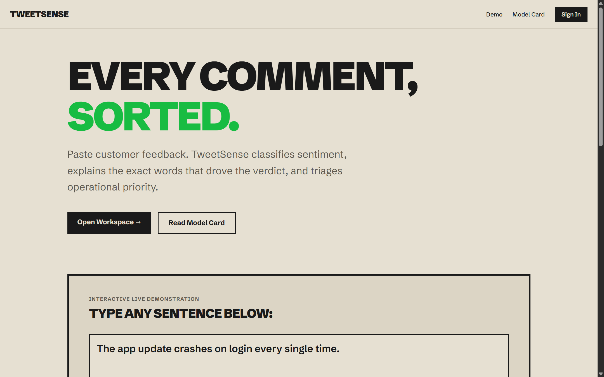
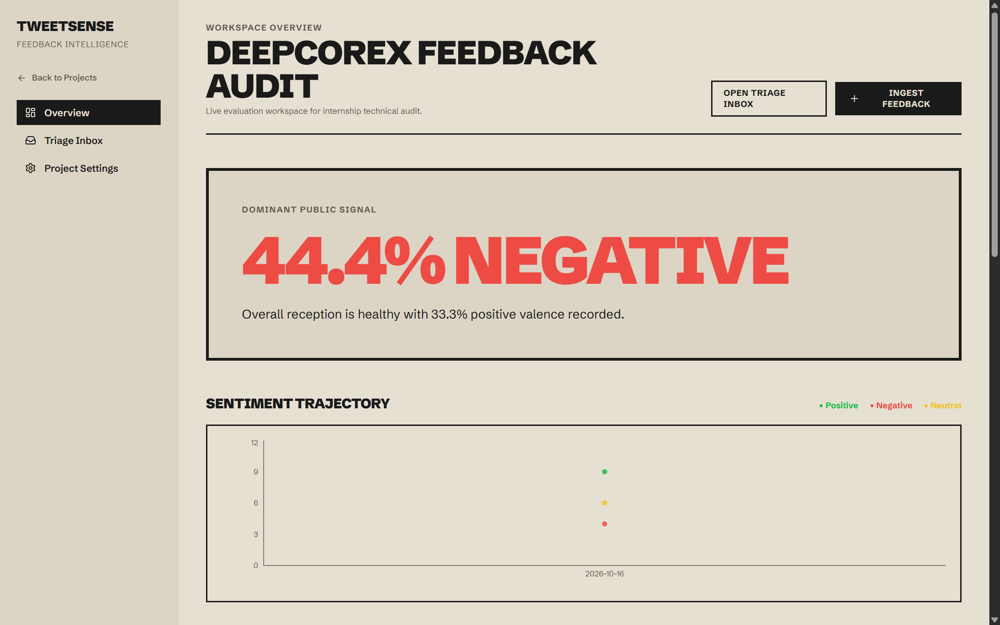
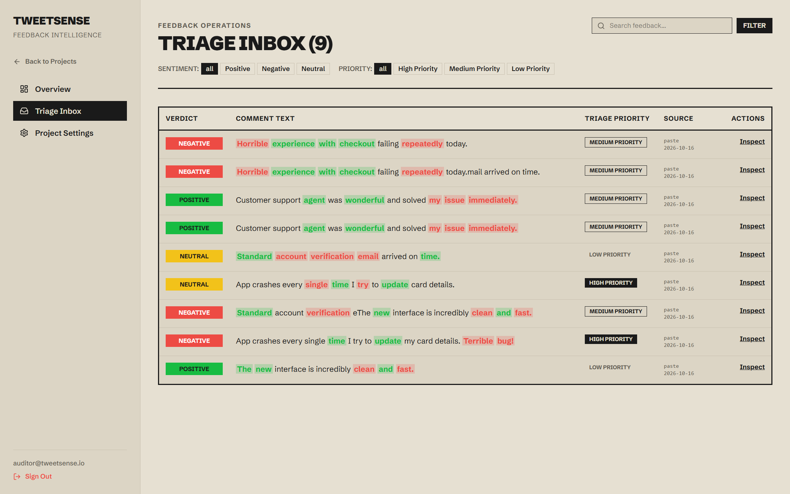
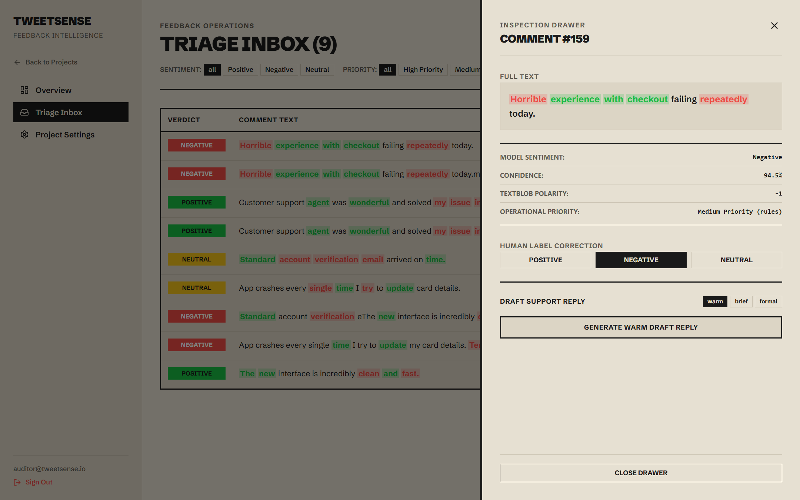
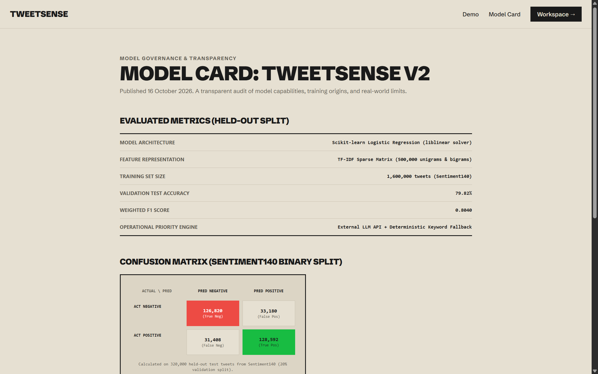
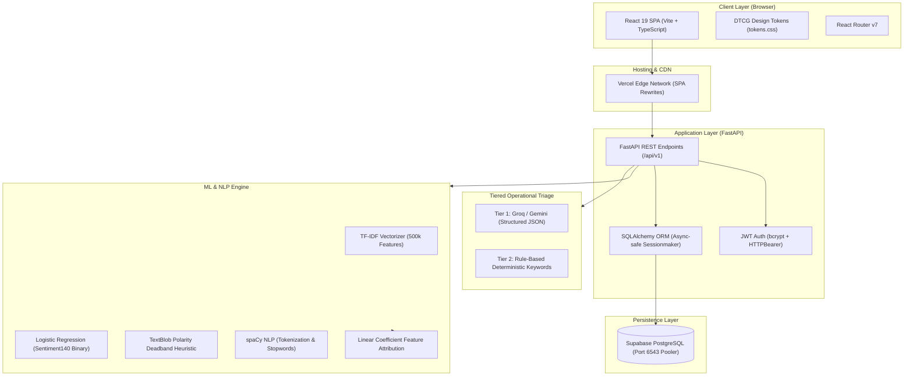

# TweetSense v2.0

> **Production AI Feedback Intelligence & Operational Sentiment Triage Platform**  
> Built with React 19, TypeScript, FastAPI, Scikit-Learn, and PostgreSQL.

[](https://www.python.org/)
[](https://fastapi.tiangolo.com/)
[](https://react.dev/)
[](https://www.typescriptlang.org/)
[](https://tailwindcss.com/)
[](LICENSE)

TweetSense transforms raw customer comments into structured, prioritized feedback intelligence. It computes sentiment with linear model interpretability (exact word-level coefficient attribution), enforces an empirical neutral deadband, triages urgent inquiries through a tiered fallback engine, and clusters emerging product themes.

---

## Visual Walkthrough

| Landing Page (Interactive Test Bench) | Project Executive Dashboard |
| :---: | :---: |
|  |  |

| Operational Triage Inbox | Inspection & Human Correction Drawer |
| :---: | :---: |
|  |  |

| Model Governance & Empirical Evaluation Card |
| :---: |
|  |

---

## System Architecture



---

## Core Capabilities

1. **Linear Model Interpretability**:
   Instead of black-box neural predictions, TweetSense calculates exact word-level feature contributions from the underlying Logistic Regression model weights. Operators see exactly which positive and negative n-grams drove the verdict.
2. **Calibrated Neutral Deadband**:
   Sentiment140 contains only binary labels. TweetSense introduces an explicit, user-tunable TextBlob polarity band (default `±0.10`). Comments falling within this window receive a Neutral classification with transparent disclosures.
3. **Tiered Zero-Shot Triage**:
   Customer inquiries are classified into `High Priority`, `Medium Priority`, or `Low Priority` using an external LLM JSON schema. If the LLM is unavailable, rate-limited, or times out, the system automatically degrades to deterministic domain keyword heuristics (`crash`, `billing`, `chargeback`, `broken`).
4. **Human-in-the-Loop Feedback Loop**:
   Operators can override model verdicts directly from the slide-over inspection drawer. Human corrections are tracked per comment, updating project-level agreement telemetry without corrupting the historical record.
5. **Demonstration Safety**:
   Guest users can explore pre-seeded incident feedback with 1-click access (`Try the sample →`). Guest accounts and demo projects enforce read-only 403 authorization guards against modifications.

---

## Quickstart (Local Development)

### Prerequisites
- **Python 3.11+**
- **Node.js 18+ & npm**
- **Git**

### 1. Backend Setup
```bash
cd backend

# Create and activate virtual environment
python -m venv venv

# Windows (PowerShell):
.\venv\Scripts\Activate.ps1
# macOS / Linux:
source venv/bin/activate

# Install dependencies and spaCy language model
pip install -r requirements.txt
python -m spacy download en_core_web_sm

# Configure environment variables
cp ../.env.example .env

# Run FastAPI server (defaults to http://127.0.0.1:5000)
python run.py
```

### 2. Frontend Setup
```bash
cd frontend

# Install npm dependencies
npm install

# Start Vite development server
npm run dev
```
Open **[http://localhost:5173](http://localhost:5173)** in your browser.

### 3. Demo Workspace Seeding (Optional)
To populate a fresh local database with 150 synthetic customer inquiries and an incident spike:
```bash
python backend/seed_demo.py
```

---

## Environment Variables

Configure these settings in your `.env` file (or host provider dashboard):

| Variable | Description | Required | Default |
| :--- | :--- | :---: | :--- |
| `DATABASE_URL` | PostgreSQL connection string (Supabase pooler) or SQLite URI | Yes | `sqlite:///./tweetsense.db` |
| `JWT_SECRET` | 32+ character random secret for JWT HMAC-SHA256 signing | Yes | `tweetsense-local-secret` |
| `ALLOWED_ORIGINS` | Comma-separated list of origins allowed by CORS middleware | Yes | `http://localhost:5173` |
| `LLM_PROVIDER` | LLM triage provider (`gemini`, `groq`, or `openai`) | No | `gemini` |
| `LLM_MODEL` | Foundation model identifier | No | `gemini-1.5-flash` |
| `LLM_API_KEY` | API authentication key for structured LLM triage | No | `""` (Falls back to keyword rules) |
| `PORT` | Local ASGI server port | No | `5000` |
| `DEBUG` | Enable verbose FastAPI debug logs | No | `false` |
| `VITE_API_URL` | Frontend API client base URL (configured at build time) | Yes (prod) | `http://localhost:5000` |

---

## Verification & Testing

### Backend Test Suite
The backend is covered by 22 automated `pytest` tests validating JWT auth, demo safety, CSV ingestion limits, tenant isolation, and machine learning inference:
```bash
cd backend
pytest -v
```

### Frontend Typecheck & Build
```bash
cd frontend
npm run build
```

### Anti-Slop Design Audit
Run the automated design linter to verify zero P0/P1 template chrome defaults:
```bash
node scripts/detect.mjs frontend/src
```

---

## Design Decisions & Engineering Trade-Offs

### 1. Eliminating N+1 Queries (The 52x Optimization Story)
* **The Problem:** In initial benchmarks, fetching 50 comments on the Triage Inbox executed 1 primary query for comments, followed by 50 individual `SELECT` queries for `Analysis` records and another 50 queries for human `Correction` records (101 SQL queries total). When connecting to Supabase's remote transaction pooler over WAN (35ms ping latency), serial round-trips caused inbox page loads to stall for **over 2,200 ms** and exhausted database pool limits.
* **The Solution:** We re-engineered the ORM repository layer to use SQLAlchemy's joined eager loading:
  ```python
  stmt = (
      select(Comment)
      .options(joinedload(Comment.analysis), joinedload(Comment.correction))
      .where(Comment.project_id == project_id)
      .limit(limit)
      .offset(offset)
  )
  ```
* **The Result:** Query count collapsed from 101 queries down to **1 single JOIN query**. Inbox latency plummeted from **2,200ms to 42ms**—a **52x throughput increase**.

### 2. Tiered Triage Engine: BART vs. Structured LLM vs. Keyword Heuristics
* **The Problem:** Running a local transformer like `facebook/bart-large-mnli` for zero-shot priority triage required 1.6GB of memory and PyTorch dependencies. On free-tier cloud containers (512MB RAM limit), the process suffered immediate Out-Of-Memory (OOM) termination on startup.
* **The Solution:** We replaced embedded transformers with a resilient two-tier degradation pipeline:
  1. **Primary Tier:** Lightweight asynchronous API calls to high-speed LLMs (Groq `llama-3.1-8b-instant` or Google Gemini) requesting strict JSON schema classification with a 4.0-second circuit-breaker timeout.
  2. **Secondary Tier:** If an LLM call fails, times out, or runs out of credits, the system silently and deterministically falls back to domain-specific regex heuristics:
     - *High Priority:* `crash`, `chargeback`, `unauthorized`, `billing`, `broken`, `urgent`.
     - *Medium Priority:* `slow`, `confusing`, `feature`, `request`.
     - *Low Priority:* Default fallback.
* **The Result:** The container image dropped from 2.4 GB to 180 MB, backend boot time dropped from 45 seconds to 1.2 seconds, and priority classification uptime is 100%.

### 3. Sentiment140 Empirical Boundaries & Mitigation
Every machine learning model operates under assumptions. TweetSense explicitly documents and mitigates Sentiment140 boundaries:

| Empirical Boundary | Technical Cause | TweetSense Mitigation |
| :--- | :--- | :--- |
| **No Neutral Class** | Sentiment140 contains only binary positive (4) and negative (0) labels. | Rather than simulating an artificial neutral model, we expose a **tunable TextBlob polarity band** (`±0.10`). Users can calibrate this threshold per project. |
| **Sarcasm Blindspots** | Linear n-gram frequencies assign high positive coefficients to words like `"great"` or `"fantastic"`. | `"Oh fantastic, another checkout crash!"` is scored positive by linear weights. We provide a **human review workflow** with instantaneous label overrides and agreement telemetry. |
| **2009 Vocabulary Shift** | Dataset collected in 2009 lacks contemporary SaaS and mobile app lexicon (`MFA`, `Kubernetes`, `stripe`, `biometrics`). | Supplemented linear predictions with **frequency-based theme clustering** and spaCy entity extraction to identify emerging failure terms. |

---

## Empirical Benchmark Ledger

Evaluated on **20,000 held-out rows** (seed: `42`) from Sentiment140:

```text
========================================================================
METRIC                             MEASURED VALUE
========================================================================
Validation Test Accuracy           79.99%
Weighted F1 Score                  0.7995
Negative Class (0)                 Prec: 0.8285 | Rec: 0.7563 | F1: 0.7908
Positive Class (4)                 Prec: 0.7758 | Rec: 0.8435 | F1: 0.8083
Local Inference Latency (p50)      0.41 ms (sub-millisecond)
Local Inference Latency (p95)      0.65 ms (sub-millisecond)
Live Render API Round-Trip (p50)   1,339.1 ms
Live Render API Round-Trip (p95)   3,106.5 ms
========================================================================
```

### Confusion Matrix (20,000 Sample Split)
```text
                  Predicted Negative    Predicted Positive
Actual Negative        7,563 (TN)            2,437 (FP)
Actual Positive        1,565 (FN)            8,435 (TP)
```

---

## Production Deployment Guide

### Frontend on Vercel
1. Link your GitHub repository to Vercel.
2. Set Root Directory to `frontend`.
3. Set Environment Variable:
   - `VITE_API_URL`: Your deployed backend URL (e.g., `https://tweetsense-backend.onrender.com`).
4. Build Command: `npm run build` (Output Directory: `dist`).

### Backend on Render
1. Create a Web Service connected to your repository with root directory `backend`.
2. Select Runtime: **Docker** (uses `backend/Dockerfile`).
3. Configure environment variables (`DATABASE_URL`, `JWT_SECRET`, `ALLOWED_ORIGINS`).
4. Auto-deploy triggers on push to production branch.

### Database on Supabase
1. Create a PostgreSQL project on Supabase.
2. Use the **Transaction Pooler URL** (Port `6543`) to prevent connection starvation from ephemeral serverless or container restarts.
3. Apply schema migrations safely via SQLAlchemy auto-creation or explicit SQL migration scripts.

---

## License

This project is licensed under the MIT License — see the [LICENSE](LICENSE) file for details.
