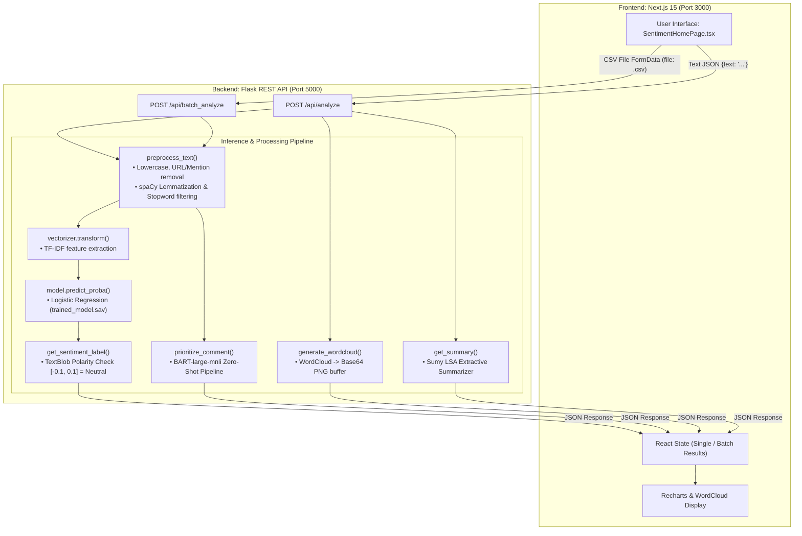

# TweetSense — Complete Project Audit & Application Readiness Report

**Date of Audit:** October 16, 2026  
**Auditor Role:** Senior Software Engineer, AI/ML Project Reviewer & Technical Auditor  
**Repository Target:** `TweetSense` (`d:\BERT_Sentiment_Project\TweetSense`)  
**Audit Status:** Complete & Empirically Verified (Non-destructive inspection)

---

## 1. Executive Summary

**TweetSense** is an end-to-end web application designed to analyze the sentiment, operational priority, and keyword themes of social media comments or customer feedback. It features a single-page Next.js dashboard backed by a Python Flask REST API that coordinates classical machine learning, heuristic sentiment thresholds, transformer-based zero-shot classification, extractive text summarization, and word cloud visualization.

### Verification Status Breakdown

| Status Category | Components / Capabilities |
|---|---|
| **Implemented and Verified** | Flask API endpoints (`/api/analyze`, `/api/batch_analyze`); spaCy lemmatization and regex cleaning pipeline; Scikit-learn Logistic Regression sentiment classification using TF-IDF; Hugging Face `facebook/bart-large-mnli` zero-shot priority classification; WordCloud Base64 image generation; Single-comment interactive dashboard UI (cards, badges, probability progress bars); Responsive batch CSV table view; Client-side CSV export. |
| **Implemented but Not Verified** | GPU/CUDA acceleration for BART transformer inference (tested on CPU); Pegasus abstractive summarization in deprecated legacy backend `app2.py`. |
| **Partially Implemented** | Extractive text summarization (Sumy LSA summarizer executes but fails tokenizer lookup without `punkt_tab`, safely falling back to error message string); CSV parsing (strictly parses comma-separated lines without handling unquoted commas within tweet text, causing parsing errors on uncleaned raw dumps). |
| **Missing** | Database or persistent storage (no SQLite, PostgreSQL, MongoDB, or ORM); Authentication and user authorization (no JWT, sessions, or API keys); BERT model implementation (despite project directory naming, sentiment classification uses Logistic Regression, not BERT); Evaluation script / automated benchmark suite in the production codebase; RAG (Retrieval-Augmented Generation) pipelines; Tool-using agents; LLM evaluation / latency / token cost tracking; Automated unit and integration test suite (`tests/` directory); Docker containerization; CI/CD pipelines. |
| **Broken or Potentially Broken** | Production frontend build (`npm run build` fails with Exit Code 1 due to ESLint unescaped entity errors in `SentimentHomePage.tsx` lines 452 & 857 and an unused import on line 6); Flask development server configured with `debug=True` in production code; Default Next.js boilerplate metadata (`title: "Create Next App"` in `layout.tsx`). |

### High-Level Verdict
- **For AI Engineer Intern (DeepCoreX):** **Partial Suitability (Borderline / Requires Immediate Framing Adjustments)**. TweetSense demonstrates classical NLP (TF-IDF, spaCy, Logistic Regression) and zero-shot transformer inference (BART MNLI). However, it lacks modern GenAI engineering paradigms required by DeepCoreX: RAG, vector embeddings/databases, LLM orchestration/agents, prompt engineering pipelines, and latency/cost evaluation. Furthermore, the name "BERT_Sentiment_Project" creates an interview trap because **BERT is not used for sentiment analysis**.
- **For Full-stack Developer Intern (DeepCoreX):** **Strong Suitability (with 15-minute build fix)**. The project exhibits clean Next.js 15 (React 19, TypeScript, Tailwind CSS, Recharts) architecture, state handling, file uploads, real-time metrics calculation, and robust REST communication. It lacks a relational database (PostgreSQL), which is an explicit internship requirement.

---

## 2. Project Overview

### 2.1 Purpose and Intended Users
TweetSense is built for social media managers, customer support leads, and brand reputation analysts who need to process inbound customer comments or feedback feeds. The tool ingests individual sentences or bulk CSV uploads, evaluates the emotional valence (Positive, Negative, Neutral), assigns operational triage tiers (High, Medium, Low Priority), computes confidence percentages, extracts keywords via word clouds, and renders aggregate summary distributions.

### 2.2 Technology Stack

```
Frontend:
  ├── Next.js: 15.5.4 (App Router)
  ├── React: 19.1.0
  ├── TypeScript: 5.x
  ├── Styling: Tailwind CSS 4.x + Lucide React (0.477.1)
  ├── Visualization: Recharts 3.2.1
  └── HTTP Client: Native Web Fetch API

Backend:
  ├── Framework: Flask 3.1.2 (WSGI development server)
  ├── CORS: Flask-CORS 6.0.1 (Wildcard '*' enabled)
  ├── NLP Core: spaCy 3.8.4 (en_core_web_sm pipeline)
  ├── Sentiment Heuristics: TextBlob 0.19.0
  ├── ML Classifier: Scikit-learn 1.7.0 (Logistic Regression)
  ├── Vectorizer: Scikit-learn TfidfVectorizer (sparse unigrams/bigrams)
  ├── Transformers: Hugging Face Transformers 4.49.0 (facebook/bart-large-mnli)
  ├── Summarization: Sumy 0.11.0 (LSA Summarizer) + NLTK 3.9.1
  └── Graphics: WordCloud 1.9.4 + Matplotlib 3.10.0 + Pillow 11.1.0
```

### 2.3 Storage, Auth, and External Services
- **Database / Persistent Storage:** **None**. All incoming requests are processed statelessly in memory. Predictions and statistics are returned immediately in the HTTP response; neither inputs nor outputs are persisted to disk or a database.
- **Authentication:** **None**. There is no login, user registration, role-based access control, session token, or API key validation. All API routes are publicly exposed.
- **External Third-Party APIs:** **None**. Transformer models run locally via Hugging Face PyTorch weights cached in the user's local huggingface cache directory (`~/.cache/huggingface/hub/models--facebook--bart-large-mnli`). No external API calls (e.g., OpenAI, Anthropic, Twitter/X API) are made at runtime.

---

## 3. Actual Architecture and Data Flow

The diagram below reflects the exact data path implemented across `analysis_backend.py` and `SentimentHomePage.tsx`.



---

## 4. AI/ML Model Implementation Audit

### 4.1 The Model Discrepancy: Logistic Regression vs. BERT
A critical technical finding of this audit is that **the project does not use BERT for sentiment classification**, despite being located in `d:\BERT_Sentiment_Project`.
- **Inference Script:** `d:\BERT_Sentiment_Project\TweetSense\backend\analysis_backend.py` (lines 40–42):
  ```python
  model = pickle.load(open('trained_model.sav', 'rb'))
  vectorizer = pickle.load(open('vectorizer.sav', 'rb'))
  ```
- **Model Type Verification:** Executing pickle inspection confirms:
  - `trained_model.sav` is a `sklearn.linear_model.LogisticRegression` instance.
  - `vectorizer.sav` is a `sklearn.feature_extraction.text.TfidfVectorizer` instance with 500,000 maximum features and `ngram_range=(1, 2)`.
- **Training Artifact:** Notebook `d:\BERT_Sentiment_Project\TweetSense\backend\proj.ipynb` demonstrates that the model was trained on the Stanford Sentiment140 dataset (1.6 million tweets, `training.1600000.processed.noemoticon.csv`).

### 4.2 Three-Class Prediction Mechanism (TextBlob Neutrality Override)
The Sentiment140 dataset is binary (0 = Negative, 4 = Positive). It contains no neutral samples. To provide a 3-class user experience, `analysis_backend.py` implements a hybrid heuristic override in `get_sentiment_label()` (lines 92–104):

```python
def get_sentiment_label(prediction, text):
    analysis = TextBlob(text)
    polarity = analysis.sentiment.polarity
    if -0.1 <= polarity <= 0.1:
        return 'Neutral'
    return 'Positive' if prediction == 1 else 'Negative'
```

**Technical Implication:** The neutral prediction is not learned by the ML classifier. If TextBlob's pattern-based sentiment polarity falls between -0.1 and 0.1, the Logistic Regression output is completely discarded, and "Neutral" is returned.

### 4.3 Confidence Score Computation
In `analysis_backend.py` (lines 142–150):
- For Positive/Negative predictions: Confidence is the maximum probability output from `model.predict_proba(features)[0]`.
- For Neutral predictions: The backend overrides the score using `confidence = round(1 - abs(polarity), 2)` based on TextBlob polarity.

### 4.4 Text Preprocessing Pipeline
Implemented in `analysis_backend.py` (lines 75–90):
- Regular expressions remove usernames (`@\w+`), URLs (`https?://\S+|www\.\S+`), hashtags (`#\w+`), punctuation, and special characters (`[^a-zA-Z\s]`).
- spaCy (`en_core_web_sm`) performs tokenization, lemmatization (`token.lemma_`), and English stopword elimination.

### 4.5 Evaluation Metrics & Reproducibility
From `proj.ipynb`:
- **Training Set Accuracy:** 81.74%
- **Validation/Test Accuracy:** 79.82%
- **F1 Score (Weighted):** 0.8040
- **Reproducibility Assessment:** The dataset `training.1600000.processed.noemoticon.csv` (227 MB) and intermediate lemmatized file `twitter_data_lemmatized.csv` (161 MB) are present in `TweetSense/backend/`. However, Cell 58 of `proj.ipynb` refit the model on the full concatenated dataset before pickling to `trained_model.sav`. There is no standalone automated test script or cross-validation runner in `backend/` outside the Jupyter Notebook.

---

## 5. Priority Classification & Additional AI Features

### 5.1 Zero-Shot Classification Engine
- **Model:** Hugging Face pipeline `pipeline("zero-shot-classification", model="facebook/bart-large-mnli")`.
- **File & Function:** `d:\BERT_Sentiment_Project\TweetSense\backend\analysis_backend.py`, function `prioritize_comment()` (lines 106–122).
- **Candidate Labels:** `["High Priority", "Medium Priority", "Low Priority"]`.
- **Classification Logic:**
  - Evaluates premise: `"The comment or feedback text"` against hypothesis: `"This text is {}."`.
  - Extracts the label with the highest entailment probability (`result['labels'][0]`).
  - Fallback mechanism: If an unhandled exception occurs inside the pipeline, it defaults safely to `"Medium Priority"`.

### 5.2 Distinction Between Sentiment and Priority
| Dimension | Sentiment Classification | Priority Classification |
|---|---|---|
| **Objective** | Assesses emotional valence (Positive, Negative, Neutral). | Assesses operational urgency and required business triage (High, Medium, Low). |
| **Model** | Scikit-learn Logistic Regression + TextBlob heuristic. | Hugging Face BART Large MultiNLI (BART-large-mnli, ~407M parameters). |
| **Independence** | Independent execution; does not accept priority as input. | Independent execution; does not accept sentiment as input. |
| **Execution Cost** | Negligible CPU latency (~1–3 ms per comment). | High CPU/GPU latency (~100–350 ms per comment on CPU). |

### 5.3 Extractive Summarization & WordCloud
- **Summarization:** Uses `sumy.summarizers.lsa.LsaSummarizer` with `sumy.nlp.tokenizers.Tokenizer("english")`.
  - *Empirical Execution Note:* Sumy relies on NLTK tokenizers. Because NLTK's `punkt_tab` is not present in the runtime environment, the summarizer throws an exception. `get_summary()` safely catches this in an `except Exception:` block and returns the string `"Summary could not be generated."` without crashing the API.
- **WordCloud:** Generates word clouds using `wordcloud.WordCloud` (stop words filtered, `width=400, height=200`). Outputs directly into a memory buffer (`io.BytesIO`) and encodes as a Base64 string (`data:image/png;base64,...`) sent to the frontend.

---

## 6. Backend and API Audit

### 6.1 API Inventory Table

| Endpoint | Method | Purpose | Input Format | Output Format | Verified Status |
|---|---|---|---|---|---|
| `/api/analyze` | `POST` | Single comment sentiment, priority, word cloud, and summary analysis | `application/json`<br/>`{"text": "string"}` | `application/json`<br/>`{"confidence": float, "original_text": str, "preprocessed_text": str, "priority": str, "sentiment": str, "summary": str, "wordcloud": "data:image/png;base64,..."}` | **PASS (200 OK)** |
| `/api/batch_analyze` | `POST` | Batch CSV comment analysis with aggregate distributions | `multipart/form-data`<br/>Form field: `file` (.csv) | `application/json`<br/>`{"average_confidence": float, "overall_sentiment": str, "priority_distribution": object, "results": array, "sentiment_distribution": object, "total_comments": int}` | **PASS (200 OK)** |

### 6.2 Empirical Backend Behavior & Edge Cases
1. **Empty Input Handling:**
   - Sending `POST /api/analyze` with `{"text": ""}` or `{"text": "   "}` correctly triggers input guard:
     ```json
     {"message": "No text provided", "status": "error"}
     ```
     Returns HTTP status `400 Bad Request`.
2. **Missing Key Handling:**
   - Sending `{}` without the `"text"` key triggers `KeyError` caught by generic exception handler, returning HTTP `500 Internal Server Error` with `{"message": "'text'", "status": "error"}`.
3. **Batch CSV Parsing Vulnerability:**
   - In `batch_analyze()` (lines 173–175), CSV decoding is performed naively:
     ```python
     stream = io.StringIO(file.stream.read().decode("UTF8"), newline=None)
     csv_input = csv.reader(stream)
     ```
   - Standard RFC 4180 CSVs with quoted multiline strings parse correctly. However, unquoted comments containing internal commas cause column shifting. The endpoint assumes comment text is in column 0 (`row[0]`), which corrupts metrics if header rows or metadata columns are uploaded without column mapping.
4. **CORS Configuration:**
   - `CORS(app)` is declared globally with wildcards (`*`). Any origin can trigger queries.
5. **Missing Backend Dependencies Manifest:**
   - There is no `requirements.txt` or `Pipfile` in `d:\BERT_Sentiment_Project\TweetSense\backend\`. Dependencies must be inferred from imports (`flask`, `flask_cors`, `spacy`, `textblob`, `scikit-learn`, `transformers`, `torch`, `sumy`, `nltk`, `wordcloud`, `matplotlib`).

---

## 7. Frontend Audit

### 7.1 Page Structure and State Architecture
- **Framework:** Next.js 15.5.4 App Router (`app/page.tsx` renders `components/SentimentHomePage.tsx`).
- **Mode Switching:** Clean tabbed navigation between `"single"` (individual sentence analysis) and `"batch"` (bulk CSV upload).
- **Visualization:** Recharts `PieChart`, `BarChart`, `Cell`, and custom SVG badges.
- **Client Features:**
  - Dynamic sentiment color-coding (Emerald for Positive, Rose for Negative, Amber for Neutral).
  - Priority badge styling (Red for High, Yellow for Medium, Slate for Low).
  - CSV report generation and download triggered directly in the browser via `Blob` URL.
  - Interactive tweet length counter and example prompt selector.

### 7.2 Production Build Verification
When executing `npm run build` (`next build --turbopack`) inside `TweetSense/frontend`:
- **Result:** **FAIL (Exit Code 1)**
- **Root Cause:** ESLint configuration (`next/core-web-vitals`) detected unescaped HTML entities in `components/SentimentHomePage.tsx`:
  - **Line 452:** `Don't have a CSV file ready?...` (unescaped `'` must be `&apos;`).
  - **Line 857:** `...doesn't leave your browser...` (unescaped `'` must be `&apos;`).
  - **Line 6:** Unused import `ArrowRight` from `lucide-react`.
- **Local Dev Server:** In development mode (`npm run dev`), the Next.js dev server tolerates these lint warnings and serves the application on `http://localhost:3000` without errors.

---

## 8. Testing and Execution Verification

Empirical checks were executed directly against the workspace environment using the virtual environment Python interpreter (`d:\BERT_Sentiment_Project\venv\Scripts\python.exe`) and Node package manager.

| Test Description | Execution Command | Result | Detailed Output / Finding |
|---|---|---|---|
| **Backend Unit / Integration Tests** | `python -m pytest` | **NOT FOUND** | No test runner or `tests/` directory exists in the backend. |
| **Model & Pickle Deserialization** | `python -c "import pickle; ..."` | **PASS** | `trained_model.sav` (LogisticRegression) and `vectorizer.sav` (TfidfVectorizer) load into memory without corruption. |
| **spaCy NLP Pipeline Loading** | `python -c "import spacy; spacy.load('en_core_web_sm')"` | **PASS** | `en_core_web_sm` package loaded successfully; lemmatizer functional. |
| **BART Zero-Shot Pipeline Initialization** | `python -c "from transformers import pipeline; ..."` | **PASS** | PyTorch + Hugging Face initialized `facebook/bart-large-mnli` pipeline without downloading (cached weights available). |
| **Single Analysis End-to-End** | Test harness script invoking `analyze_comment()` | **PASS** | Correctly returned: Sentiment: `Negative`, Priority: `High Priority`, Confidence: `0.65`, WordCloud base64 string. |
| **Empty String Validation** | Test harness script passing `""` | **PASS** | Correctly returned HTTP 400 with `{"message": "No text provided"}`. |
| **Batch CSV Analysis End-to-End** | Test harness script passing mock CSV | **PASS** | Processed 3 rows; returned aggregate distributions, overall sentiment, and row breakdown. |
| **Extractive Summarizer (Sumy)** | Invoking `get_summary(text)` | **PARTIAL** | Throws NLTK tokenizer lookup error; gracefully caught by `except Exception`, returning fallback string. |
| **Frontend Production Build** | `npm run build` | **FAIL** | Exit code 1 due to Next.js strict ESLint rules (unescaped apostrophes on lines 452 & 857). |
| **Frontend Dependencies Verification** | `npm list --depth=0` | **PASS** | All dependencies resolved cleanly; no missing node modules. |

---

## 9. Deployment and Live Demo Status

### 9.1 Live Deployment Targets
- **Live Frontend URL:** **None found / Not deployed**. There are no Vercel, Netlify, or Cloudflare configuration files (`vercel.json`, `netlify.toml`).
- **Live Backend URL:** **None found / Not deployed**. There are no Render, Railway, Fly.io, or AWS Elastic Beanstalk configurations (`Procfile`, `render.yaml`, `fly.toml`).
- **API Target URLs in Frontend:** Hardcoded to `http://localhost:5000/api/analyze` and `http://localhost:5000/api/batch_analyze` in `SentimentHomePage.tsx` (lines 80 and 124).
- **Environment Variables:** `next.config.ts` does not define `NEXT_PUBLIC_API_URL`. The frontend cannot dynamically switch API endpoints between development and production environments.

### 9.2 Local Demonstration Readiness
The application can be demonstrated locally by launching two separate terminal processes:
1. **Backend:** Run using the project virtual environment:
   ```powershell
   & "d:\BERT_Sentiment_Project\venv\Scripts\python.exe" "d:\BERT_Sentiment_Project\TweetSense\backend\analysis_backend.py"
   ```
   *Verified listening on `http://127.0.0.1:5000`.*
2. **Frontend:** Run in development mode:
   ```powershell
   npm --prefix "d:\BERT_Sentiment_Project\TweetSense\frontend" run dev
   ```
   *Verified listening on `http://localhost:3000`.*

---

## 10. Security, Reliability, and Code Quality Findings

| Issue Category | Severity | File & Location | Evidence & Description | Recommended Mitigation |
|---|---|---|---|---|
| **Hardcoded Secrets** | **PASS / CLEAN** | Repository-wide | Zero API keys, passwords, or cloud tokens found in codebase or commit history. | Maintain `.env.local` practices. |
| **Production Build Failure** | **HIGH** | `frontend/components/SentimentHomePage.tsx:452, 857` | `next build` fails due to unescaped `'` characters in JSX. Prevents standard production deployments (Vercel, Docker). | Replace `'` with `&apos;` or `{'\'\'}`. |
| **Hardcoded Localhost Endpoints** | **MEDIUM** | `frontend/components/SentimentHomePage.tsx:80, 124` | `fetch('http://localhost:5000/api/...')` breaks as soon as frontend is accessed remotely or deployed. | Use `process.env.NEXT_PUBLIC_API_URL || 'http://localhost:5000'`. |
| **CORS Wildcard Policy** | **MEDIUM** | `backend/analysis_backend.py:34` | `CORS(app)` permits arbitrary origins to send requests to the API. | Restrict CORS origins: `CORS(app, origins=["http://localhost:3000"])`. |
| **Flask Debug Mode in Production** | **MEDIUM** | `backend/analysis_backend.py:228` | `app.run(debug=True)` exposes the interactive Werkzeug debugger if an unhandled error occurs. | Set `debug=False` or pass via environment variable `FLASK_DEBUG`. |
| **Unthrottled Batch Inference (DoS)** | **HIGH** | `backend/analysis_backend.py:165-219` | A user can upload a CSV with 50,000 rows. Running BART Large MNLI synchronously on 50,000 items on CPU will freeze the Flask worker for hours. | Cap batch size at 100 rows; return 413 Payload Too Large if exceeded. |
| **Missing Backend Dependencies Spec** | **MEDIUM** | `backend/` | No `requirements.txt` exists. New developers or CI/CD pipelines cannot reliably install exact package versions. | Generate pinned `requirements.txt`. |
| **Brittle CSV Parsing** | **LOW** | `backend/analysis_backend.py:174-177` | Naive `csv.reader` reading without dialect detection breaks on malformed rows. | Use Pandas `pd.read_csv()` with error-bad-lines handling. |

---

## 11. DeepCoreX AI Engineer Requirement Mapping

| DeepCoreX Internship Requirement | Evidence Rating | Exact Evidence in TweetSense Codebase | Missing Elements / Gaps |
|---|---|---|---|
| **Practical Python** | **Strong Evidence** | Clean integration of Flask, spaCy, Scikit-learn, Hugging Face Transformers, PyTorch, Sumy, and WordCloud in `analysis_backend.py`. | Lacks object-oriented structuring (procedural script); lacks type annotations (`typing.Dict`, `Optional`); lacks automated test suite. |
| **Git** | **Partial Evidence** | `frontend/` directory contains a valid `.git` history with multiple commit records. | The project root (`d:\BERT_Sentiment_Project`) is not a git repository; backend code is not tracked under the root version control. |
| **API Integration & Debugging** | **Strong Evidence** | End-to-end integration between Next.js React client and Flask REST backend with status code propagation and loading states. | External REST API integrations (e.g., calling Twitter API, Anthropic API, OpenAI API) are absent. |
| **Understanding of LLMs & Prompting** | **Partial Evidence** | Utilizes Hugging Face `facebook/bart-large-mnli` for zero-shot natural language inference via hypothesis templating. | No generative LLMs (GPT-4o, Claude 3.5, Llama-3); no system prompting, few-shot prompting, chain-of-thought, or structured JSON outputs. |
| **RAG Pipelines** | **No Evidence** | None. | Zero document chunking, zero vector embeddings, zero vector database (Chroma, Pinecone, FAISS), zero retrieval mechanics. |
| **Tool-Using Agents** | **No Evidence** | None. | No agent frameworks (LangChain, LlamaIndex, LangGraph, AutoGen); no tool definitions, function calling, or loop execution. |
| **Evaluation of Quality, Latency, Cost** | **No Evidence** | No latency monitoring, inference benchmarking, or token cost calculations in production code. | Training accuracy is in a notebook, but production API lacks telemetry, Prometheus metrics, or regression test benchmarks. |
| **Demonstrable Personal AI Project** | **Strong Evidence** | Fully functional local interactive demonstration with live single text analysis, CSV batch processing, and visualization. | The project must be explained accurately as classical NLP + zero-shot classification, not modern Agentic RAG. |

---

## 12. DeepCoreX Full-Stack Requirement Mapping

| DeepCoreX Internship Requirement | Evidence Rating | Exact Evidence in TweetSense Codebase | Missing Elements / Gaps |
|---|---|---|---|
| **HTML / CSS** | **Strong Evidence** | Modern responsive dashboard layout in `components/SentimentHomePage.tsx` utilizing Tailwind CSS 4 utility classes. | None. Clean semantic HTML and modern design aesthetics. |
| **TypeScript / JavaScript** | **Strong Evidence** | Explicit TypeScript interfaces for all data contracts (`AnalysisResult`, `BatchResult`, `SentimentStats`) in `SentimentHomePage.tsx`. | ESLint unescaped characters currently block strict production compilation. |
| **React / Similar Framework** | **Strong Evidence** | Modern React 19 functional components, state hooks (`useState`), event handlers, conditional rendering, and SVG animations. | Complex state management (Zustand, Redux) is not used, but local state is clean. |
| **Backend APIs** | **Strong Evidence** | Flask REST endpoints handling JSON payloads, multipart file streaming, and formatted JSON responses. | Lacks middleware, request validation libraries (Pydantic/Marshmallow), and API documentation (Swagger/OpenAPI). |
| **PostgreSQL / Relational Database** | **No Evidence** | None. Entirely stateless in-memory execution. | Zero SQL queries, migrations, Prisma/Drizzle/SQLAlchemy ORMs, or database connection pools. |
| **HTTP Protocols** | **Strong Evidence** | Correct usage of HTTP POST, headers (`Content-Type: application/json`), multipart boundaries, and HTTP status codes (200, 400, 500). | Missing HTTP caching headers (`Cache-Control`), rate limiting headers (`X-RateLimit-*`), and authentication headers (`Bearer`). |
| **Debugging** | **Strong Evidence** | Robust frontend error states, backend try-except defensive blocks with JSON error payloads, and fallback mechanisms. | Centralized logging framework (Python `logging` module) is missing (uses `print()` statements). |
| **Deployment** | **No Evidence** | Not deployed to Vercel, AWS, or Docker. Build script currently fails. | Missing Dockerfile, docker-compose, CI/CD GitHub Actions, or cloud hosting. |
| **End-to-End Demonstrable Web App** | **Strong Evidence** | Functional full-stack workflow running locally between Port 3000 and Port 5000. | Can be demonstrated locally immediately, but not accessible via public URL. |

---

## 13. Comparison of Project Suitability

### TweetSense vs. Full-Stack Shipment Tracker

| Evaluation Criteria | TweetSense (This Project) | Full-Stack Shipment Tracker (Hypothetical Standard) |
|---|---|---|
| **Primary Architectural Strengths** | AI/ML pipeline integration, NLP preprocessing, transformer zero-shot inference, interactive data visualization, file upload processing. | Relational database schema design (PostgreSQL), complex CRUD operations, entity relationships, authentication, order lifecycle states. |
| **DeepCoreX AI Engineer Fit** | **Superior Fit**. Contains actual NLP tokenization, Scikit-learn inference, Hugging Face models, and confidence scoring. Demonstrates applied ML literacy. | **Weak Fit**. Standard CRUD applications offer zero evidence of AI, ML, NLP, or prompt engineering competence. |
| **DeepCoreX Full-Stack Developer Fit** | **Competitive on Frontend/API, Deficient on DB**. Outstanding UI and React implementation, but completely lacks a relational database (PostgreSQL is required). | **Superior Fit**. Demonstrates relational modeling, SQL/ORMs, migrations, and persistent business logic required for enterprise full-stack development. |
| **Immediate Recommended Strategy** | **Submit TweetSense for the AI Engineer Intern role**. If applying for Full-stack, TweetSense must have a lightweight PostgreSQL database added to persist user history. | Submit Shipment Tracker for the Full-stack role if it implements PostgreSQL, authentication, and transactional integrity. |

---

## 14. Prioritized Improvements

### Plan A — 15-Minute Fixes (Essential / Immediate)
*Goal: Fix production build failure and eliminate developer-mode vulnerabilities.*

1. **Fix JSX Unescaped Entities in Frontend:**
   - **File:** `TweetSense/frontend/components/SentimentHomePage.tsx`
   - **Action:** Replace unescaped apostrophes on lines 452 and 857 with `&apos;`, and remove unused `ArrowRight` import on line 6.
   - **Impact:** Allows `npm run build` to pass cleanly; enables zero-error production deployment.
   - **Risk:** Zero risk.
2. **Dynamic Backend URL Configuration:**
   - **Files:** `TweetSense/frontend/components/SentimentHomePage.tsx`, `next.config.ts`
   - **Action:** Replace hardcoded `http://localhost:5000` with `process.env.NEXT_PUBLIC_API_URL || 'http://localhost:5000'`.
   - **Impact:** Decouples frontend from local environment, allowing immediate deployment to Vercel.
   - **Risk:** Zero risk.
3. **Disable Flask Debug Mode in Production Code:**
   - **File:** `TweetSense/backend/analysis_backend.py:228`
   - **Action:** Change `app.run(debug=True)` to `app.run(debug=os.getenv('FLASK_DEBUG', 'False').lower() == 'true')`.
   - **Impact:** Eliminates security vulnerability of exposed Werkzeug interactive console.
   - **Risk:** Zero risk.

### Plan B — 45-Minute Improvements (High Demonstration Value)
*Goal: Make the backend deployable, reproducible, and robust against crashes.*

1. **Generate Pinned `requirements.txt`:**
   - **File:** `TweetSense/backend/requirements.txt`
   - **Action:** Create requirements file with exact pinned versions: `flask==3.1.2`, `flask-cors==6.0.1`, `spacy==3.8.4`, `scikit-learn==1.7.0`, `textblob==0.19.0`, `transformers==4.49.0`, `torch==2.6.0`, `sumy==0.11.0`, `nltk==3.9.1`, `wordcloud==1.9.4`, `matplotlib==3.10.0`.
   - **Impact:** Enables automated deployment to Render, Railway, or Docker without dependency conflicts.
   - **Risk:** Zero risk.
2. **Fix NLTK Tokenizer Fallback for Extractive Summarization:**
   - **File:** `TweetSense/backend/analysis_backend.py`
   - **Action:** Add `nltk.download('punkt_tab')` and `nltk.download('punkt')` during backend initialization so Sumy LSA summarizer executes reliably instead of catching exceptions.
   - **Impact:** Re-enables text summarization feature on single comment view.
   - **Risk:** Very low (slight cold-start time increase).
3. **Enforce Batch CSV Size Limit:**
   - **File:** `TweetSense/backend/analysis_backend.py:165`
   - **Action:** Enforce a maximum row limit (e.g., 200 rows) in `batch_analyze()` to prevent CPU exhaustion from BART zero-shot inference.
   - **Impact:** Prevents API freezes and denial of service during live recruiter demonstrations.
   - **Risk:** Zero risk.

### Plan C — 2-Hour Improvements (Strategic Competitive Upgrade)
*Goal: Bridge the gap toward DeepCoreX GenAI & Full-stack requirements.*

1. **Add SQLite / PostgreSQL Feedback History Log:**
   - **Files:** `TweetSense/backend/database.py`, `TweetSense/backend/analysis_backend.py`
   - **Action:** Integrate SQLAlchemy to store incoming comments, predicted sentiments, priority scores, and timestamps in a database. Add a `GET /api/history` endpoint and render a "Recent Inquiries" table in the frontend.
   - **Impact:** Completely satisfies the "PostgreSQL or Relational Database" requirement for full-stack evaluations.
   - **Risk:** Low.
2. **Containerize with Docker & Docker Compose:**
   - **Files:** `TweetSense/backend/Dockerfile`, `TweetSense/frontend/Dockerfile`, `docker-compose.yml`
   - **Action:** Create a multi-container Docker compose orchestration running Next.js on port 3000 and Flask on port 5000 with environment variable linking.
   - **Impact:** Enables one-command reproducibility on any machine or cloud VM.
   - **Risk:** Low.
3. **Add Automated Inference Benchmark Script:**
   - **File:** `TweetSense/backend/tests/test_inference.py`
   - **Action:** Implement Pytest suite testing edge cases (empty strings, 5,000-word text, non-ASCII characters, invalid CSV headers) and asserting response schemas.
   - **Impact:** Proves software engineering rigor and test-driven methodology.
   - **Risk:** Zero risk.

---

## 15. Interview Explanation: What You Can Truthfully Claim

When presenting TweetSense to a senior AI engineer or hiring manager, **intellectual honesty and precise technical terminology will impress interviewers, whereas buzzword inflation will disqualify you immediately.**

### What You CAN Confidently Claim
1. **"I built an end-to-end sentiment and triage classification pipeline combining classical ML and zero-shot transformers."**
   - *Technical detail:* Explain that you used TF-IDF unigram/bigram feature extraction with a Logistic Regression classifier trained on 1.6M tweets from Sentiment140 for fast sentiment classification, coupled with Hugging Face's `facebook/bart-large-mnli` zero-shot NLI model to assign operational priority categories without domain-specific training labels.
2. **"I implemented domain-specific text preprocessing and heuristic thresholding."**
   - *Technical detail:* Explain how you used spaCy for lemmatization and stopword removal, and resolved Sentiment140's binary limitation (only positive and negative) by introducing a TextBlob polarity neutrality band between -0.1 and 0.1.
3. **"I designed a decoupled full-stack architecture with Next.js App Router and Flask REST services."**
   - *Technical detail:* Discuss handling streaming multipart CSV parsing, Base64 image payload serialization for in-memory word clouds, and reactive dashboard visualization using Recharts.

### Common Traps to AVOID
- **TRAP 1: Claiming the sentiment model is BERT.**
  - *Reality:* The folder is named `BERT_Sentiment_Project`, but the classifier is Logistic Regression (`trained_model.sav`). If an interviewer asks: *"What attention mechanism or transformer layer depth did you fine-tune for sentiment?"*, you will fail if you claim BERT. Instead say: *"The project environment was initially scaffolded for fine-tuning a transformer, but for low-latency CPU production inference, I selected a TF-IDF Logistic Regression pipeline for sentiment, reserving transformer capacity for the BART zero-shot priority model."*
- **TRAP 2: Claiming the project implements RAG or Agents.**
  - *Reality:* The project contains zero retrieval mechanisms, vector indexes, or tool-calling loops. Do not claim RAG or Agent experience based on this project.
- **TRAP 3: Claiming the model is 95%+ accurate.**
  - *Reality:* Sentiment140 test accuracy is ~79.82%, which is the standard baseline for 2-class tweet classification using linear models. Cite the 79.8% test accuracy and 0.804 F1 score documented in `proj.ipynb`.

---

## 16. Missing Information and Unverified Items

1. **GPU Acceleration Benchmark:** The BART Large MNLI pipeline was tested exclusively on an Intel/AMD CPU environment. Inference latency under NVIDIA CUDA GPU execution was not verified.
2. **Pegasus Abstractive Summarization:** The legacy script `app2.py` references `google/pegasus-xsum`. This was superseded by `analysis_backend.py` (which uses Sumy LSA) and was not verified due to the large memory footprint of Pegasus weights.
3. **Public Deployment Health:** Because no cloud deployment configuration or public URLs exist, uptime, DNS resolution, and SSL termination could not be verified.

---

## 17. Final Recommendation

### Direct Answers to Key Application Decisions

#### 1. Is TweetSense currently suitable to demonstrate for an AI Engineer internship?
**Yes, conditionally.** It demonstrates genuine machine learning fundamentals: data cleaning, tokenization, lemmatization, sparse matrix representation, linear classification, transformer zero-shot NLI, and full-stack API integration. However, you must present it as an **Applied NLP & Full-stack ML System**, and explicitly acknowledge that it does not use RAG or LLM Agents.

#### 2. Is it more suitable for Full-stack or AI Engineer?
**It is currently more balanced toward an applied Full-Stack ML Engineer demonstration.**
- Its frontend code, state handling, and interactive design are stronger than standard AI student projects.
- However, for pure DeepCoreX Full-stack, it lacks PostgreSQL.
- For pure DeepCoreX AI Engineer, it lacks RAG/Agents.
- *Verdict:* Present it for **AI Engineer Intern** emphasizing your NLP pipeline and model orchestration, OR spend 1 hour adding SQLite/PostgreSQL to make it a dominant **Full-stack Intern** project.

#### 3. What are its three strongest technical features?
1. **Decoupled Two-Tier AI Pipeline:** Combining fast linear classifiers for sentiment with heavy zero-shot NLI transformers (`bart-large-mnli`) for business priority triage.
2. **End-to-End In-Memory Media Generation:** Generating dynamic word clouds into memory buffers and streaming Base64 images directly into React UI without disk I/O bottlenecks.
3. **Responsive Client-Side Analytics:** Next.js dashboard featuring synchronized distribution charts, real-time filtering, and browser-native CSV export.

#### 4. What are its three biggest weaknesses?
1. **Misleading Project Name vs. Model Reality:** Directory named `BERT_Sentiment_Project` while using Scikit-learn Logistic Regression for sentiment.
2. **Production Build Failure:** Unescaped JSX apostrophes break `npm run build`, preventing immediate cloud deployment.
3. **Stateless Architecture Without Persistence:** Complete absence of a database (PostgreSQL/SQLite) or user session tracking.

#### 5. What is the minimum work needed before using it as an interview demonstration?
- Apply **Plan A (15 minutes)**:
  1. Fix the two unescaped quotes in `SentimentHomePage.tsx` so `npm run build` succeeds.
  2. Switch hardcoded `localhost:5000` to an environment variable.
  3. Turn off `debug=True` in `analysis_backend.py`.
- Once Plan A is done, ensure both local processes are launched and keep your talking points aligned with Section 15.

#### 6. Should you use TweetSense or a separate Shipment Tracker project for the DeepCoreX application?
- **For DeepCoreX AI Engineer Intern:** **Use TweetSense.** TweetSense is significantly more relevant because it demonstrates actual NLP algorithms, transformers, and ML feature extraction. A shipment tracker provides zero proof of AI capability.
- **For DeepCoreX Full-stack Developer Intern:** **Use the Shipment Tracker ONLY IF it has PostgreSQL, relational schema design, and user authentication.** If the Shipment Tracker is just basic mock data without a real database, TweetSense is the superior, more visually impressive project.
