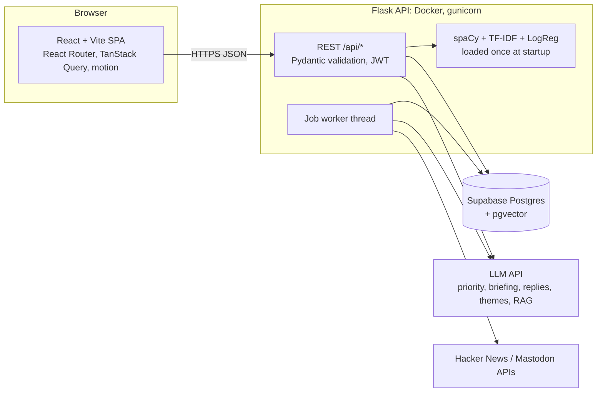

# TweetSense v2: Ideation & Build Blueprint

*Written 16 Oct 2026, for the DeepCoreX Full-stack Intern application (deadline 12:00 PM).*
*Companion files: `TWEETSENSE_PROJECT_AUDIT.md` and `PROJECT_UNDERSTANDING_INTERVIEW_DOSSIER.md`.*

---

## 0. TL;DR

**The pitch.** TweetSense stops being "a tweet sentiment checker" and becomes a **feedback intelligence workspace**. You create a project ("Product launch feedback"), feed it comments (paste, CSV, public APIs), and get back sentiment *with the words that drove it*, themes, priorities, a plain-English briefing, and drafted replies that a human approves. Everything is saved per user in Postgres.

**The big moves**

| Move | From | To |
|---|---|---|
| Frontend | Next.js 15 (one 959-line component) | **React + Vite + TypeScript** SPA, split into routes and components |
| Backend | Flask, stateless | Flask kept (don't rewrite), plus Postgres, JWT auth, jobs, tests |
| Priority model | `bart-large-mnli` (multi-GB, can't deploy free) | **LLM API call with typed JSON + rule-based fallback** |
| Storage | none | **Supabase Postgres** (+ pgvector for the stretch RAG feature) |
| Design | one dark-theme dashboard | **Two layers**: art-directed public pages (your taste-skill) and a calm, dense workspace that shares its tokens |
| Hosting | localhost | **Vercel** (static SPA) + **Render or HF Spaces** (Flask Docker) + **Supabase** |

**A correction to my earlier advice.** I told you to copy Linear: dark theme, one indigo accent, glass-ish minimal look. Your taste-skill bans exactly that (no indigo/violet, no glass, no thin rules, no icon-card grids, no gradients). That look is the "average of every AI-built dashboard", which is what you said you don't want. This blueprint replaces it. Section 6 has the real direction.

**The cut line.** Anything below *Wave 3* in Section 9 is a bonus. If the clock gets tight, deploy at the end of Wave 2 and stop adding features.

---

## 1. Decisions locked

| Topic | Decision | Why |
|---|---|---|
| Frontend framework | React 19 + Vite + TypeScript, **not Next.js** | You don't know Next.js and the app doesn't need SSR. A Vite SPA is simpler: one `index.html`, one router. |
| Routing | React Router v7 (data router) | Verified via Context7 (Section 5). |
| Server state | TanStack Query v5 | Caching, pagination, optimistic updates without hand-written effects. |
| Local UI state | React state + two small contexts (auth, theme) | No Redux or Zustand. Fewer things to explain. |
| Styling | Tailwind CSS v4 (Vite plugin) with **our own CSS variables**, plus plain CSS for set pieces | Tokens come from the dealt direction, not from a component kit's defaults. |
| Components | Radix primitives (dialog, popover, dropdown) restyled by our tokens | Behaviour and accessibility for free, no default "shadcn look". |
| Motion | `motion` (`motion/react`) | Layout animations, stagger, scroll entrances, `MotionConfig reducedMotion="user"`. |
| Charts | Recharts for standard charts, hand-built SVG for the signature visuals | Flat fills, direct labels, no gridlines. |
| Backend | Flask + SQLAlchemy + Pydantic + PyJWT/bcrypt, gunicorn | Your pipeline already works. Rewriting to FastAPI costs time and gains nothing visible. "FastAPI or similar" in the JD covers Flask. |
| Database | Supabase Postgres via the **pooler URL**, plain SQL/SQLAlchemy | Don't use Supabase Auth or the JS client. The JD says "APIs with validation, authentication", so your own JWT auth is the proof. |
| Priority step | LLM API (Gemini free tier or any key you have), JSON validated by Pydantic, 8 s timeout, one retry, rule-based fallback | Deployable, demonstrates LLM integration, and never breaks a live demo. |
| Name | Keep **TweetSense**. Stop using the `BERT_` folder name anywhere public. | Avoids the interview trap flagged in the audit. |

---

## 2. Product concept

### 2.1 One-sentence positioning
> Paste a pile of customer comments. TweetSense tells you what people feel, what to answer first, and *why it thinks so*.

### 2.2 Who it's for (one persona, keep it concrete)
**Maya, support lead at a small SaaS.** After a release she gets 400 comments across email exports, a CSV from the survey tool, and a Hacker News thread. She needs: what's the mood, what are the top three complaints, which ones must be answered today, and draft replies she can edit and send.

### 2.3 The user journey
1. **Landing page.** The headline is an input. Type a comment, watch the verdict and the driving words appear live.
2. **"Try the sample project".** One click, no signup, a pre-filled read-only demo project (the single most important feature for a reviewer).
3. **Sign up** (email + password) when they want their own.
4. **Create a project**, add comments (paste / CSV / public source).
5. **Project dashboard**: mood, themes, priority queue, trend.
6. **Inbox/triage**: fix wrong labels, move comments through New → In progress → Resolved, draft replies.
7. **Share** a read-only report link.

### 2.4 Demo mode (do this early)
Seed one demo project (about 150 comments across 3 sources and 3 weeks, a visible negative spike, a few corrections, two themes). Guest users get read-only access. A reviewer sees a full dashboard in five seconds without creating an account. Write a `seed_demo.py` script and run it at deploy time. **Use obviously synthetic comments. Never present invented comments as real customers.**

---

## 3. Feature catalogue

Legend: **A** = core, **B** = strong, **C** = stretch, **X** = skip.

| # | Feature | Tier | Est. build | Interview value |
|---|---|---|---|---|
| 1 | Auth (register/login/JWT/bcrypt) | A | 15 min | High: JD lists authentication |
| 2 | Projects/workspaces | A | 10 min | Medium |
| 3 | Ingestion: paste + CSV with column mapping | A | 15 min | High |
| 4 | Analysis engine + saved results | A | 15 min | High |
| 5 | Explainable predictions (driving words) | A | 15 min | **Very high** |
| 6 | Dashboard + insights | A | 25 min | High |
| 7 | History/inbox (search, filter, paginate, delete) | A | 15 min | High |
| 8 | Demo mode + landing live demo | A | 20 min | Very high |
| 9 | Model card + eval page | A | 10 min | High |
| 10 | Human corrections + agreement rate | B | 15 min | **Very high** |
| 11 | Theme clustering | B | 20 min | High |
| 12 | Spike detection | B | 10 min | Medium |
| 13 | AI batch briefing | B | 10 min | High |
| 14 | Reply drafts with approve/edit step | B | 15 min | High: mirrors "human approval" in the AI JD |
| 15 | Share link + CSV/PDF export | B | 15 min | Medium |
| 16 | Public sources: Hacker News, Mastodon | B/C | 20 min | Medium |
| 17 | Triage board (drag and drop) | C | 25 min | Medium |
| 18 | Compare mode (two projects/periods) | C | 20 min | Medium |
| 19 | Ask-your-data (RAG with citations) | C | 40 min | **Very high**, but risky |
| 20 | Webhook alerts (Slack/Discord) | C | 10 min | Low-medium |
| 21 | API keys + OpenAPI docs + `/metrics` | C | 20 min | High for the JD's observability line |
| 22 | Model-vs-model comparison | C | 25 min | Medium |
| X | Chrome extension, live X/Twitter API, roles, password reset, real-time sockets | X | - | Not worth the risk |

### 3.1 Core features in detail

**1. Auth.** `POST /api/auth/register|login`, `GET /api/auth/me`. bcrypt, JWT with 24 h expiry, consistent `{status, message}` errors, per-user data isolation on every query (`WHERE user_id = :uid`). Keep the token in memory plus `localStorage` (state this trade-off in the README).

**2. Projects.** A project owns comments, settings (`neutral_band`, default 0.10), themes, and a share token. Every other table hangs off `project_id`.

**3. Ingestion.** Paste box (one comment per line), CSV upload with a **column-mapping step** (the audit flagged the old `row[0]` assumption as brittle: use pandas, let the user choose the text column and optional date/source columns). Cap at 500 rows per upload; ingestion runs as a job (3.4 below).

**4. Analysis engine.** The existing pipeline, unchanged: spaCy lemmatization → TF-IDF → Logistic Regression → TextBlob neutral band. Store `sentiment`, `confidence`, `polarity`, `latency_ms`, `model_version`. Make the **neutral band per-project and visible** in settings. It is a heuristic, and exposing the knob is more honest than hiding it.

**5. Explainable predictions.** Logistic Regression is linear, so each word's contribution is `coef × tfidf_value`. Rank, keep the top 3 positive and top 3 negative, and highlight them in the comment text.

```python
# at startup
FEATURE_NAMES = vectorizer.get_feature_names_out()
COEF = model.coef_[0]          # class 1 = positive

def explain(clean_text: str, top_n: int = 3):
    row = vectorizer.transform([clean_text]).tocoo()
    contrib = [(FEATURE_NAMES[j], float(COEF[j] * v)) for j, v in zip(row.col, row.data)]
    contrib.sort(key=lambda t: t[1])
    return {"negative": contrib[:top_n], "positive": contrib[-top_n:][::-1]}
```

Notes: features are **lemmas and bigrams**, so map them back to the original tokens in the UI (match on the spaCy lemma of each original token). Display words with a tone-step background highlight (not underlines). When the neutral band overrides the model, say so in the UI: "Neutral: the polarity score is inside the neutral band."

**6. Dashboard.** See Section 6.8 for the layout. Metrics: total comments, share positive/neutral/negative, average confidence, p50/p95 latency, priority counts, daily counts (30 days), top 15 keywords, open tickets.

**7. History/inbox.** Table with search, sentiment and priority filters, source filter, date range, pagination (TanStack Query `placeholderData: keepPreviousData`), bulk delete. Virtualize if you pass 500 rows (TanStack Virtual).

**8. Landing live demo.** The headline input calls a **public, rate-limited** `POST /api/demo/analyze` that runs only the light pipeline (no LLM). Static fallback: three precomputed examples shown when JS or the API is unavailable.

**9. Model card + eval page.** Static facts you can honestly claim: Logistic Regression + TF-IDF (500k features, 1-2 grams), Sentiment140 (1.6M tweets, 2009), about 79.8% test accuracy, 0.804 weighted F1, the neutral class is a polarity band, no sarcasm handling, trained on 2009 tweets so modern slang and emoji are out of distribution. Add a confusion matrix and per-class precision/recall **computed from a held-out split you actually run** (a notebook cell exporting `eval.json` is enough). Do not display numbers you didn't compute.

### 3.2 Strong features in detail

**10. Corrections + agreement rate.** A "this label is wrong" control stores `corrections(comment_id, user_id, corrected_sentiment)`. Show: reviewed count, **agreement rate among reviewed comments only** (say that in the caption: reviewed items are a biased sample), and the most-corrected phrases. This is a real human-in-the-loop story and the honest answer to "your Neutral class is a heuristic, so how do you know it's wrong?"

**11. Theme clustering.** For projects with 30+ comments: TF-IDF → NMF or KMeans (k chosen between 3 and 8 by silhouette score), keep the top 8 terms and 3 representative comments per cluster. **One LLM call** names all clusters at once ("delivery delays", "pricing confusion"), returning JSON validated with Pydantic. If the call fails, fall back to the top-3 terms as the label. Runs as a job.

**12. Spike detection.** Per day, compute the negative share. Flag a day when it exceeds the trailing 7-day mean by more than 2 standard deviations **and** the day has at least 10 comments. Show the flag on the chart as a direct label ("Tue 14: 71% negative, usual 34%"). State the rule in the UI.

**13. AI batch briefing.** One LLM call over aggregate stats plus the top themes plus 10 sampled high-priority comments, returning `{headline, top_issues[3], suggested_actions[3]}`. Show the sampled comments it used (so it's checkable), cache the result per project version, and label it as AI-generated.

**14. Reply drafts with human approval.** For a comment, pick a tone (warm, brief, formal) and stream a draft. Status flow: `draft → approved → copied`. **Nothing sends automatically.** The UI makes the human step explicit (an "Approve" action, an edit field, a "Copy reply" button). Backend: Pydantic-typed output, one bounded retry, and a log of latency and token usage.

**15. Share link + export.** `share_token` on a project gives a read-only report page (`/r/:token`) with the dashboard and briefing, with raw comment text hidden by default (privacy). Export: CSV now, print-friendly report page for "Save as PDF".

**16. Public sources.** Hacker News (Algolia search API) and Mastodon hashtag timelines need no paid access. Fetch server-side, store with `source`, and keep the fetch limit small (50 per pull). Check each API's current terms and rate limits before relying on it. Skip YouTube unless you already have a key.

### 3.3 Stretch features in detail

**17. Triage board.** Columns: New, In progress, Resolved. `@dnd-kit` for drag, `motion` layout animation for the settle. Persist `status` and `position`. Only build this after the inbox is solid.

**18. Compare mode.** Two projects, or two date ranges in one, side by side: share per sentiment, top themes, top driving words. Good fit for "before vs after launch".

**19. Ask-your-data (RAG).** The one feature that makes the project credible for the AI Engineer role too.
- Embed each comment at ingest (job) and store in Postgres with pgvector.
- Query: embed the question → cosine top-k (k = 8) → LLM answers **only from the retrieved comments** and cites comment IDs → UI shows the cited comments beside the answer.
- **Refuse when retrieval is weak**: if the best similarity is below a threshold, answer "I can't find that in your comments" rather than guessing.
- Pick one embedding provider and set the vector dimension to match it. The column dimension must equal the model's output size.
- Mini-eval: write 8 questions with known answers from the demo project and show hit-rate of the right comment in the top-k. Even a small table here maps onto the JD's "evaluate retrieval" line.

Verified pgvector SQL (from the Supabase docs via Context7):

```sql
create extension if not exists vector with schema extensions;

create table comment_embeddings (
  comment_id bigint primary key references comments(id) on delete cascade,
  embedding extensions.vector(768)   -- change to your embedding model's dimension
);

create index on comment_embeddings using hnsw (embedding vector_cosine_ops);

-- similarity = 1 - cosine distance; order by distance ascending
select c.id, c.text, 1 - (e.embedding <=> :query_embedding) as similarity
from comment_embeddings e join comments c on c.id = e.comment_id
where c.project_id = :pid
order by e.embedding <=> :query_embedding
limit 8;
```

**21. API keys + OpenAPI + metrics.** A settings page generates a key (store only a hash and a prefix, show it once). `POST /api/v1/analyze` accepts `X-API-Key`. Swagger docs via `flask-smorest` or `apispec`. `/metrics` in Prometheus format (request count, latency histogram) lines up with the JD's OpenTelemetry/Prometheus/Grafana stack.

### 3.4 Background jobs without extra infrastructure
You don't need Celery or Redis for this. Use a `jobs` table (`kind`, `status`, `progress`, `error`) and a single in-process worker thread started with the app. The UI polls `GET /api/jobs/:id` every 1.5 s through TanStack Query's `refetchInterval` and shows a progress bar. Say plainly in the README: "single-process worker, fine for demo scale; I'd move to a queue (RQ/Celery) with Redis at real scale." That sentence shows you understand the trade-off.

---

## 4. Architecture & data



### 4.1 Tables

| Table | Key columns |
|---|---|
| `users` | id, email (unique), password_hash, created_at |
| `projects` | id, user_id, name, description, neutral_band, share_token (nullable), is_demo, created_at |
| `comments` | id, project_id, source, text, posted_at, lang, created_at |
| `analyses` | comment_id (PK, FK), sentiment, confidence, polarity, priority, priority_reason, priority_source (`llm`\|`rules`), top_words (JSON), latency_ms, model_version |
| `corrections` | id, comment_id, user_id, corrected_sentiment, created_at |
| `themes` | id, project_id, label, keywords (JSON), size, run_id |
| `comment_themes` | comment_id, theme_id |
| `tickets` | comment_id (PK), status, note, position |
| `reply_drafts` | id, comment_id, tone, body, status (`draft`\|`approved`\|`copied`), created_at |
| `comment_embeddings` | comment_id (PK), embedding (vector) |
| `jobs` | id, project_id, kind, status, progress, error, created_at |
| `api_keys` | id, user_id, prefix, key_hash, created_at, last_used |
| `webhooks` | id, project_id, url, rule |

### 4.2 Endpoint groups

| Group | Endpoints |
|---|---|
| Auth | `POST /api/auth/register`, `POST /api/auth/login`, `GET /api/auth/me` |
| Projects | `GET/POST /api/projects`, `GET/PATCH/DELETE /api/projects/:id`, `POST /api/projects/:id/share` |
| Ingest | `POST /api/projects/:id/comments` (paste), `POST /api/projects/:id/import` (CSV + mapping), `POST /api/projects/:id/pull` (HN/Mastodon) |
| Comments | `GET /api/projects/:id/comments` (filters, pagination), `DELETE /api/comments/:id`, `POST /api/comments/:id/correct`, `PATCH /api/comments/:id/ticket` |
| Insights | `GET /api/projects/:id/stats`, `GET /api/projects/:id/themes`, `POST /api/projects/:id/briefing`, `GET /api/projects/:id/spikes` |
| LLM | `POST /api/comments/:id/reply-draft`, `PATCH /api/reply-drafts/:id`, `POST /api/projects/:id/ask` |
| Jobs | `GET /api/jobs/:id` |
| Public | `POST /api/demo/analyze` (rate-limited), `GET /api/share/:token`, `GET /api/health`, `GET /metrics` |
| Developer | `POST /api/keys`, `DELETE /api/keys/:id`, `POST /api/v1/analyze` |

**Tip for Antigravity: write the contract first.** Have it produce an `API_CONTRACT.md` (endpoints, request/response JSON, error shape) *before* any code. Then the backend agent and the frontend agent can work in parallel against the same document.

---

## 5. Moving from Next.js to React (Vite)

### 5.1 What this means in plain terms
Next.js adds a server, file-based routing, and special conventions on top of React. Your app doesn't use the server part: it's a single client page calling Flask. So the move is mostly **copying components and changing a few imports**.

| In Next.js | In Vite + React |
|---|---|
| `app/page.tsx`, `app/layout.tsx` | A route object in `router.tsx` and a layout component rendered with `<Outlet />` |
| `"use client"` at the top of files | Not needed. Everything is client-side. |
| `process.env.NEXT_PUBLIC_API_URL` | `import.meta.env.VITE_API_URL` (**the commonest gotcha**; `VITE_` prefix required) |
| `next/font`, `metadata` export | `<link>` for the font in `index.html`, `<title>` in `index.html` |
| `next/link`, `next/navigation` | `Link`, `useNavigate` from `react-router` |
| Vercel auto-detects Next | Vercel needs a **rewrite to `index.html`** so deep links like `/dashboard` don't 404 |

Your existing `SentimentHomePage.tsx` is plain React plus Tailwind plus Recharts, so most of the JSX ports directly. Split it into components while moving.

### 5.2 Router (verified against current React Router docs via Context7)
In v7 the imports come from `react-router` and the provider from `react-router/dom`. Create the router once, outside the component tree. A route without a `path` is a pathless **layout route**, which is how you share the sidebar or the marketing layout.

```tsx
// router.tsx
import { createBrowserRouter } from "react-router";

export const router = createBrowserRouter([
  { Component: MarketingLayout, children: [
      { index: true, Component: Landing },
      { path: "login", Component: Login },
      { path: "model", Component: ModelCard },
      { path: "r/:token", Component: SharedReport },
  ]},
  { Component: RequireAuth, children: [        // redirects to /login when no token
    { Component: AppShell, children: [         // sidebar + <Outlet />
        { path: "app", Component: Projects },
        { path: "app/p/:projectId", Component: ProjectDashboard },
        { path: "app/p/:projectId/inbox", Component: Inbox },
        { path: "app/p/:projectId/ask", Component: Ask },
        { path: "app/settings", Component: Settings },
    ]},
  ]},
]);

// main.tsx
import { RouterProvider } from "react-router/dom";
createRoot(document.getElementById("root")!).render(<RouterProvider router={router} />);
```

### 5.3 Motion (verified)
Wrap the app once so every animation respects the OS "reduce motion" setting: `reducedMotion="user"` disables transform and layout animations while keeping opacity and colour changes.

```tsx
import { MotionConfig } from "motion/react";
<MotionConfig reducedMotion="user"><RouterProvider router={router} /></MotionConfig>
```

### 5.4 Data fetching (verified)
Paginated tables should keep the old page visible while the next one loads, using `placeholderData: keepPreviousData` and `isPlaceholderData` to disable "Next" until data arrives. For optimistic UI (correcting a label, dragging a card), use `onMutate` to snapshot and update the cache, `onError` to roll back, and `onSettled` to `invalidateQueries`.

```tsx
const { data, isPlaceholderData } = useQuery({
  queryKey: ["comments", projectId, filters, page],
  queryFn: () => api.comments(projectId, { ...filters, page }),
  placeholderData: keepPreviousData,
});
```

### 5.5 Suggested folder structure
```
frontend/
  index.html                  # font link, title, favicon
  vite.config.ts              # react plugin + @tailwindcss/vite
  vercel.json                 # rewrite everything to /index.html
  src/
    main.tsx  router.tsx
    styles/tokens.css  base.css  marketing.css   # CSS variables first
    api/client.ts  types.ts   # fetch wrapper (adds JWT, handles 401), shared types
    auth/AuthContext.tsx  RequireAuth.tsx
    hooks/                    # useProjects, useComments, useStats, useJob...
    pages/                    # Landing, Login, Projects, ProjectDashboard, Inbox, Ask, ModelCard, Settings, SharedReport
    components/
      marketing/              # HeadlineInput, CallResponse, Ledger, FaqText, CtaBand, FooterContact
      app/                    # Verdict, DrivingWords, SentimentField, PriorityTag, ThemeList, SpikeNote, ReplyDraft, JobProgress
      charts/                 # TrendArea, SentimentBar, KeywordList (hand-built SVG)
      ui/                     # Button, Dialog, Menu, Field (Radix + tokens)
backend/
  app/ (create_app, models.py, schemas.py, auth.py, ml.py, llm.py, jobs.py, routers/)
  tests/  seed_demo.py  Dockerfile  requirements.txt
docker-compose.yml  README.md  API_CONTRACT.md
```

### 5.6 Library shortlist
`react`, `react-dom`, `react-router`, `@tanstack/react-query`, `@tanstack/react-table` (+ `react-virtual` if lists get long), `motion`, `recharts`, `@dnd-kit/core` + `sortable`, `cmdk`, `sonner`, `react-hook-form` + `zod`, `@radix-ui/*` primitives, `tailwindcss` + `@tailwindcss/vite`, `vitest` + Testing Library. Pin exact versions and check each against Context7 when you use it (Section 8).

---

## 6. Design system: how it should look

### 6.1 What your taste-skill is and isn't for
It is an art-direction system for **public pages** (landing, marketing, portfolio). Its own description says "Not for dashboards or app screens." So I split the product into two layers that share one set of tokens:

| Layer | Pages | Rules |
|---|---|---|
| **Marketing layer** | Landing, login/signup screen, model card, shared report header | Follow the taste-skill fully: dealt direction, idea sentence, real pictures, motion layer, run `lint.mjs` and `inspect.mjs`. |
| **App layer** | Projects, dashboard, inbox, ask, settings | Same tokens, same type, same house rules where they apply (no glass, no gradients, no shadows at rest, no icon-card grids, no eyebrow labels, no indigo/violet). Allowed exceptions: real tables and form fields keep their lines, and data charts get axes. |

### 6.2 The dealt direction (reproducible)
Dealt with the skill's own script for sector `ai-product`, from three options (borrowed-category, dark-room, type-only-statement). **Chosen: "Type and nothing else"**, because TweetSense has no photographs of its own, and its real "material" is typed text, verdicts and words. A comment you can type into is a better first screen than a stock picture.

| Slot | Dealt value |
|---|---|
| Direction | Type and nothing else (seed **880307066**) |
| Hero | "Controls on the sentence" |
| Type | **Schibsted Grotesk**, display weight 800, tracking -0.05em, leading 0.88; text 400/600, leading 1.4 |
| Colour | "Poster chapters" |
| Sections | how-it-works (call and response column) → showcase (headline you can type) → stats (column aligned on the decimal) → faq (answers as reading text) → cta (one word is the button) → footer (contact as the headline) |
| Motion signature | Masked headline: each line rises from behind its own baseline (about 900 ms, second line +110 ms) |

To regenerate the identical sheet (needs Node 22+), run from the project root:

```bash
node <skill>/scripts/draw.mjs --sector ai-product \
  --brief "TweetSense: a workspace that turns piles of customer comments into themes, priorities and replies" \
  --sections how-it-works,showcase,stats,faq,cta,footer --have product-ui \
  --direction type-only-statement --seed 880307066
```

**Settle conflicts using the skill's own order:** house rules → direction → type/palette → hero → sections. If a blueprint disagrees with a house rule, the house rule wins. The sheet lists "Adjusted for this page" notes; follow them.

### 6.3 The idea (the sentence the skill requires)
> On this page, **a raw customer comment** becomes **the headline itself: an input you type into, with the verdict reading back live.**

**The live thing** (one only): the "headline you can type" section. You type a comment; underneath, at true interface size, the answer updates: the sentiment field, confidence, the driving words highlighted, and a priority note. Three plain-text example buttons refill the line. It works on a phone with a thumb, and without script it shows three precomputed examples.

Competitor test: another sentiment tool *could* have a text box, but "the comment is the headline and the verdict is the page" is specific to a product whose entire material is the sentence. Keep the box, but make sure it is the largest thing on the screen, not a form in a card.

### 6.4 Colour tokens (from the dealt palette, plus semantic mapping)

```css
:root {
  --bg: #e6e0d2;        --surface: #dcd5c5;
  --ink: #1a1a1a;       --muted: #5f5b52;
  --accent: #18bc42;    --accent-ink: #1a1a1a;
  --field-coral:  #ed4b44;   --field-black: #1a1a1a;
  --field-green:  #18bc42;   --field-yellow: #f2c21a;  --field-bone: #e6e0d2;
  --radius: 0;           /* square corners everywhere, decided once */
}
```

**Semantic mapping (my adaptation for the app layer):** the poster palette already contains a traffic-light set, so use it as data colour.

| Meaning | Field |
|---|---|
| Positive | green `#18bc42`, ink text |
| Neutral | yellow `#f2c21a`, ink text |
| Negative | coral `#ed4b44`, ink text |
| Priority | **not colour**: High = ink-filled tag with bone text, Medium = surface-tone tag, Low = plain muted text |

That keeps sentiment readable at a glance without a second colour system. The primary action button is ink-filled on bone. The green accent is used on the landing CTA band and for "positive", not for random decoration.

**Dark ("night") theme:** ground `#1a1a1a`, ink `#e6e0d2`, surface one tone step lighter (derive it, e.g. `#242424`). Same sentiment fields.

### 6.5 Landing page argument (claims → sections)
The skill says write the page as claims with proof, and delete any section that has no claim.

| Section | Claim | Proof on the page |
|---|---|---|
| Hero | "Every comment, sorted." (22 characters, fits two lines at every width) | The three chips are the product's real knobs (neutral band, confidence floor, priority sensitivity). If dragging them to restyle the headline feels gimmicky when built, redraw the hero slot and record why. |
| how-it-works | You give comments, it gives answers | Three call/response exchanges: *First, paste your comments.* → a real fragment showing sorted themes. *Then ask what's going wrong.* → the briefing. *Finally, answer the people who matter.* → a reply draft **waiting for approval**. Responses are real HTML fragments marked `data-ui`. |
| showcase | See it work on your own words | The live headline input (6.3). |
| stats | Honest numbers | 79.8% test accuracy, 0.804 weighted F1, 1.6M training tweets, plus the **measured** latency of your own deployed endpoint. Nothing invented. |
| faq | Straight answers | "Is Neutral learned?" No, it's a polarity band you can adjust. "Does it read sarcasm?" No. "Is my data used to train anything?" Answer truthfully for your build. "Who writes the replies?" The AI drafts, you approve. Set as run-in reading text, no accordions. |
| cta | The action | One word as the whole band: **Analyze** (7 letters). |
| footer | Contact as the headline | Your real email address set at 8-9vw. |

Headline alternatives (all ≤ 32 characters): "Every comment, sorted." / "Read the room, fast." / "What are they really saying?" Pick one and write the two-line break by hand for the masked-line animation.

### 6.6 Imagery plan
The skill's floor is **at least four real pictures**, and for software, cropped interface fragments count (SVG drawings don't). Plan:
- **Product fragments (`data-ui`)**: the verdict card, the themes list, the briefing, the reply draft, the dashboard ledger. Built in HTML with real labels and numbers that add up. Never a fake dashboard of grey bars, never a device frame.
- **Found pictures of the subject's world**: sorting and listening are the product's metaphors. Use the skill's `assets.mjs` to search open collections for archival images such as a post-office sorting room, pigeonholes full of letters, telephone switchboard operators. Download with `--get`, credit them on the page (`--credits` prints the line), and never present them as the product or its customers.
- **One moving picture** where an honest clip exists (`assets.mjs --video`), as a muted loop with a poster frame.
- The optional "Water" atmosphere photos on the sheet are not needed here.

### 6.7 App-layer rules (how the workspace avoids looking generic)
1. **No card grids.** Content is organised by scale and position, not rows of identical tiles.
2. **Separate with tone, not lines.** Surfaces step from `--bg` to `--surface`. Tables and form fields may keep lines (the skill's own exception).
3. **Big numbers set like a ledger.** KPIs use the stats blueprint: large tabular figures aligned on the decimal, captions on the baseline, 20 px of space between rows.
4. **Sentiment is a field, not a dot.** A comment's verdict is a solid colour block with the label, not a small coloured circle.
5. **Charts have direct labels and flat fills.** No gridlines, no legends where a label on the series works, no gradients, no glow, no shadow.
6. **One accent, used sparingly. No violet or indigo. Sentence case. No tiny uppercase letter-spaced labels. No monospace** except real code (the API key and code samples).
7. **Sidebar is a plain list** (wordmark, five links), not a glass bar or floating pill.
8. **Everything has states**: skeleton loaders in surface tone, written empty states ("No comments yet. Paste some or load the sample."), error toasts with a retry.
9. **Type scale:** five steps max, from the sheet's `--step-small`, `--step-body`, `--step-lead`, `--step-head`, plus the display size. Body text 16px or larger. Full-ink running text.

### 6.8 Screen by screen

**Projects.** A list set in large type: project name at display-ish size, with a one-line stat ("212 comments, 61% negative") beside it. "New project" is a single text-sized button. No tile grid.

**Project dashboard.** Opens with **one big statement figure** ("61% negative this week") at display size, with one sentence of context and the spike note if any. Below it, a full-width **flat area chart** of daily sentiment (direct-labelled), then the **decimal-aligned ledger** (total, average confidence, p50/p95 latency, open tickets), then **themes as a ranked list** (theme name large, keywords small, count aligned right), then the **AI briefing** as reading text. Top driving words sit as a plain ranked column.

**Inbox.** A dense table (lines allowed) with a wide comment column; each row's verdict is a coloured field; driving words highlighted inline; hover reveals "wrong label", "draft reply", "ticket". Filters as a quiet row above. Command palette (Ctrl+K) for jump/add/filter.

**Comment detail (slide-over).** Original text with highlighted driving words, the explanation line, the confidence and the neutral-band note, the correction control, the priority tag with its one-sentence reason and its source ("LLM" or "rules"), then the reply draft editor with Approve and Copy.

**Ask.** A single large input as the page headline (echoing the landing page). Answer below as reading text with **numbered citations** that open the cited comments in place. "I can't find that" is a valid result.

**Model card / eval.** Reading-text layout with the ledger of numbers, the confusion matrix as a simple coloured grid (only place a grid of cells is justified), and a short "what this can't do" section.

**Shared report (`/r/:token`).** The dashboard minus controls, with the project title as the headline and the "made with TweetSense" line as the footer's contact headline.

### 6.9 Motion plan
- **Landing:** masked headline (signature), staggered entrances for each section's heading → text → fragment (60-90 ms steps, 16-32 px rise with opacity, once), button press/hover feedback, one moving picture. The skill's inspector counts moving elements and fails pages under eight.
- **App:** number count-up on the big figure, bars/areas drawing in once, comment rows entering with a small stagger, `layout` animations when cards move or filters reorder, slide-over spring.
- **Rules:** transform and opacity only, content visible if JS fails, wrapped in `MotionConfig reducedMotion="user"`.

### 6.10 Quality gate for the marketing layer
Run `lint.mjs` on the source and `inspect.mjs` on the running page. The inspector opens a real browser at 1440, 768 and 390 px, saves screenshots, and fails banned patterns (gradients, thin rules, eyebrows, monospace, 3-line headlines, near-empty screens, too little motion). Fix every FAIL, then **look at the screenshots** and critique them with `references/critique.md`. (Requires Node 22+ and Chrome/Edge/Chromium; `assets.mjs` needs network.)

---

## 7. Inspiration & resources

### 7.1 Where to look (for ideas, not to copy)
| Need | Where |
|---|---|
| Award-level layout and type ideas | Awwwards, One Page Love (the taste-skill's study came from these), Godly, Land-book |
| Typography | Typewolf (pairings), Fontshare, Google Fonts / Fontsource |
| App-screen patterns | Mobbin, Refero, Page Flows |
| Restrained data dashboards | Plausible and Fathom Analytics (clean, number-forward), Stripe's reporting screens |
| Behaviour and keyboard UX | Linear and Raycast, **for interaction patterns only, not for the look** |
| Motion mechanics | motion.dev examples, React Bits, Motion-Primitives |
| Component mechanics | Radix Primitives docs, React Aria, 21st.dev |

**A warning on component galleries** (21st.dev, Magic UI, Aceternity, shadcn blocks): many of them are glass, gradient and glow heavy, which is exactly the look you want to avoid. Take the *mechanics* (focus handling, keyboard support, animation timing) and restyle everything with your tokens.

### 7.2 Documentation to keep open
react.dev, vite.dev, reactrouter.com, tanstack.com/query and /table, motion.dev, recharts.org, tailwindcss.com, flask.palletsprojects.com, sqlalchemy.org, docs.pydantic.dev, supabase.com/docs (pgvector, connection pooling), render.com/docs, vercel.com/docs.

### 7.3 Free data to demo with
Sentiment140 (what you trained on, but don't use training rows as "customer comments" in the demo), Hacker News Algolia API, Mastodon public timelines. Write synthetic demo comments yourself for the seeded project, and label them as sample data.

---

## 8. Using Context7 and your taste-skill inside Antigravity

**Context7 (current library docs).** Add "use context7" to any prompt that touches a library API, and name the library. IDs I verified in this session:

| Library | Context7 ID |
|---|---|
| React Router | `/remix-run/react-router` |
| Motion | `/websites/motion_dev` |
| TanStack Query | `/tanstack/query` |
| Supabase (pgvector, pooling) | `/supabase/supabase` |

Rule of thumb: **if Antigravity writes `react-router-dom` imports, `framer-motion` imports, or a v4 TanStack `useQuery(['key'], fn)` signature, it's using stale memory. Make it check Context7.** (Current: `react-router`, `motion/react`, and the v5 object form `useQuery({ queryKey, queryFn })`.)

**Taste-skill.** For marketing pages, tell Antigravity to read the skill's `SKILL.md`, run the `draw.mjs` command above with seed **880307066**, write the argument (claims table), the idea sentence and a copy deck *before* markup, then build, then run `lint.mjs` and `inspect.mjs`, and finally report. For app pages, tell it to apply the house rules and the tokens but not the page blueprints.

---

## 9. Build waves (with a cut line)

Antigravity is fast, but this is still a lot. Work in waves. **Each wave ends in a working, committed state.** Deploy at the end of Wave 2, and again after each later wave.

| Wave | Scope | Done when |
|---|---|---|
| **0. Scaffold** (about 10 min) | `API_CONTRACT.md`; Vite + React + TS + Tailwind v4; tokens and fonts; router skeleton; `VITE_API_URL`; fix backend basics (`debug` via env, CORS from env, requirements.txt, drop BART/torch, LLM priority with fallback, `.gitignore` for the 228 MB and 328 MB CSVs) | `npm run build` passes and the API boots locally |
| **1. Data + auth** | Postgres models, register/login/JWT, projects, paste + CSV ingestion with column mapping, analysis saved per comment, explain(), history endpoint, pytest (auth, isolation, analyze, empty input, batch cap) | Tests green, the contract is implemented |
| **2. Core UI + first deploy** | App shell, login, projects, analyze/ingest flow, inbox with filters and pagination, comment detail with driving words, corrections, minimal landing page, Dockerfile, deploy | **A public URL works end to end. This is your submission fallback.** |
| **3. Insights + landing** | Dashboard (big figure, area chart, ledger, keywords), spike note, theme clustering job, AI briefing, demo project seeding, full taste-skill landing page with the live headline demo, model card/eval page, README | Reviewer can open the link and see a populated project in five seconds |
| **4. LLM workflow** | Reply drafts with approval, share link, CSV export, Hacker News pull, command palette | Shipped if time allows |
| **5. Stretch** | Triage board, ask-your-data RAG with citations and mini-eval, API keys + OpenAPI + `/metrics`, compare mode, webhooks | Only after everything above is deployed and stable |

**Order of cuts if time runs out:** Wave 5 first, then compare mode, then the board, then public sources, then PDF/export polish, then the landing's extra sections. Never cut: auth, saved history, deployment, the demo project, the README.

**Parallelism:** once `API_CONTRACT.md` exists, run the backend and frontend agents in parallel against it. Merge at the end of each wave.

---

## 10. Deployment

| Piece | Where | Notes |
|---|---|---|
| Frontend | Vercel | Build `npm run build`, output `dist`. Add `vercel.json`: `{ "rewrites": [{ "source": "/(.*)", "destination": "/index.html" }] }`. Set `VITE_API_URL`. |
| Backend | Render (Docker) **or** a Hugging Face Docker Space | gunicorn with 1 worker, 120 s timeout, models loaded once at startup. Without torch the image is small. Check the host's current free-tier RAM/sleep rules before choosing. |
| Database | Supabase | Use the **pooler** connection string, `sslmode=require`. Run `create extension vector` only if you build RAG. |

**Environment variables.** Backend: `DATABASE_URL`, `JWT_SECRET`, `ALLOWED_ORIGINS`, `LLM_API_KEY`, `LLM_MODEL`, `FLASK_DEBUG=false`, `EMBEDDING_MODEL` (if RAG). Frontend: `VITE_API_URL`. Never commit `.env`; commit `.env.example`.

**Free-tier habits.** Cold starts are real: open the app yourself a few minutes before the deadline and before any demo. A free uptime pinger hitting `/api/health` can keep it warm. Set a spending cap or low quota on the LLM key, and rate-limit every endpoint that calls it.

---

## 11. Honest claims and the interview script

### 11.1 What you can say
- "Full-stack app: React/TypeScript SPA, Flask REST API, Postgres, JWT auth, tests, Docker, deployed."
- "Sentiment is TF-IDF + Logistic Regression trained on Sentiment140 (about 79.8% test accuracy, 0.804 weighted F1). Because the model is linear, I can show which words drove each prediction."
- "Neutral isn't learned. It's a TextBlob polarity band you can adjust per project, and the corrections feature measures how often users disagree."
- "Priority, themes naming, briefings and drafts use an LLM API with validated JSON output, timeouts, one retry and a rule-based fallback. Replies need human approval."

### 11.2 What not to say
- Don't call the sentiment model BERT or "deep learning".
- Don't claim RAG or agents unless you actually built and can explain feature 19.
- Don't quote accuracy numbers you didn't compute from a split you ran.
- Don't present synthetic demo comments as real customer data.

### 11.3 A 90-second demo
1. Open the landing page, type a sarcastic comment, point at the driving words and the confidence.
2. Click the sample project. Show the big figure and the spike.
3. Open the inbox, correct one label, show the agreement rate change.
4. Open a theme, show its example comments.
5. Draft a reply, show the Approve step.
6. Close on the model card: "here's what it can't do."

### 11.4 Failure stories worth having ready
Pick two you really hit: BART not fitting on a free tier (so you swapped to an LLM call with a fallback), `VITE_` env var not being read, CORS blocked after deploy, Supabase pooler vs direct connection, the neutral band misclassifying a sarcastic comment.

---

## 12. Risks

| Risk | Mitigation |
|---|---|
| Scope too big for the time | The cut line in Section 9. Deploy after Wave 2. |
| Backend too heavy for free hosting | No torch/BART; measure RAM locally before deploying. |
| LLM quota or outage in the demo | Rule-based fallback for priority; briefing and drafts show a clear "unavailable" state, not a crash. |
| Cold start on the reviewer's first click | Warm it up before sharing; pinger on `/api/health`. |
| Stale library code from the AI | "use context7" on every library task; check imports against Section 8. |
| Generic UI creeping back | Tokens only, no card grids, run `inspect.mjs`, look at the screenshots. |
| Can't explain code you didn't write | Reread Section 11 and have Antigravity write a short `ARCHITECTURE.md` you actually read. |

---

## Appendix A: Rules block to paste at the top of the Antigravity session

```
Project rules for TweetSense v2:
1. Frontend is React + Vite + TypeScript. No Next.js. Use react-router (v7),
   @tanstack/react-query v5, motion/react. For ANY library API, use context7
   first; do not rely on memory.
2. Write API_CONTRACT.md before code. Backend and frontend follow it exactly.
3. Design tokens live in src/styles/tokens.css. No hardcoded colours.
   No gradients, glass, shadows at rest, indigo/violet, icon-card grids,
   eyebrow labels or monospace (except real code). Square corners.
4. Marketing pages follow the design-taste-frontend skill (seed 880307066,
   direction type-only-statement). App pages use the same tokens and rules,
   not the page blueprints.
5. Never invent proof: no fake customers, quotes or statistics. Demo data is
   labelled as sample data.
6. Every wave ends with tests passing, a committed state, and a short note on
   what was built and what was assumed.
7. LLM calls: validated JSON, timeout, one retry, fallback, never auto-send.
```

## Appendix B: Wave 0 checklist (do this first, 10 minutes)
- [ ] `git init` at the project root; `.gitignore` excludes `*.csv` datasets, `node_modules`, `.env`
- [ ] Remove `torch`/`transformers` from the deployed backend
- [ ] `requirements.txt` pinned; `debug` from env; `ALLOWED_ORIGINS` from env
- [ ] Vite app scaffolded; `VITE_API_URL` wired; `npm run build` passes
- [ ] Supabase project created; pooler URL copied; `.env.example` written
- [ ] Render (or HF Space) and Vercel projects created and linked to the repo
