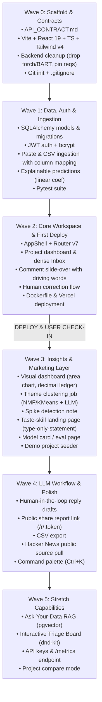

# TweetSense v2: End-to-End Implementation Plan

**Date:** 16 October 2026  
**Context:** DeepCoreX Full-stack Intern Application  
**Target:** Transform TweetSense from a stateless prototype into a production-grade, deployed, explainable feedback intelligence workspace.

---

## 1. Architectural & Engineering Guardrails

1. **Frontend:** React 19 + Vite + TypeScript SPA (`react-router` v7 data router, `@tanstack/react-query` v5, `motion/react`). No Next.js. Environment variables prefixed strictly with `VITE_`.
2. **Styling & Design System:** Pure design tokens via CSS variables (`src/styles/tokens.css`). No hardcoded colors, no gradients, no glassmorphism, no resting shadows, no violet/indigo, no eyebrow labels, no icon-card grids, no monospace outside real code. Square corners (`--radius: 0`). Sentiment colors: positive green (`#18bc42`), neutral yellow (`#f2c21a`), negative coral (`#ed4b44`). Priority is represented by tone/fill, never color.
3. **Backend:** Flask REST API retaining working Scikit-learn + TF-IDF + spaCy pipeline (`trained_model.sav` and `vectorizer.sav` untouched). Torch/transformers/BART removed to meet lightweight free-tier deployment limits.
4. **Priority & GenAI:** External LLM API (Google Gemini / OpenAI / Groq) with Pydantic-validated JSON schemas, 8-second timeout, 1 retry, and deterministic rule-based fallback. All AI-generated replies require explicit human approval (`draft -> approved -> copied`).
5. **Database & Storage:** Supabase PostgreSQL accessed via Transaction Pooler connection string (`sslmode=require`) using SQLAlchemy and Pydantic schemas. Stateless local SQLite fallback for development testing when cloud credentials are pending.
6. **Integrity & Naming:** Never refer to the sentiment model as "BERT". Model metrics are strictly derived from notebook evaluation (~79.8% test accuracy, 0.804 weighted F1). Demo comments are synthetic and marked "sample data".
7. **Secrets & Git:** Exclude large CSV datasets (`training.1600000.processed.noemoticon.csv` and `twitter_data_lemmatized.csv`), virtual environments, and `.env` files from git before the initial commit. Provide `.env.example`. Ask user for secrets (`DATABASE_URL`, `JWT_SECRET`, `LLM_API_KEY`) when reaching deployment/integration steps.

---

## 2. Wave Breakdown & Execution Roadmap



---

### Wave 0: Scaffold & Contracts (Est: 20 min)
*Goal: Establish strict API contracts, clean backend footprint, and initialize Vite SPA with design token foundation.*

#### Tasks:
1. **Repository Setup:**
   - Initialize root Git repository at `d:\BERT_Sentiment_Project\TweetSense`.
   - Create root `.gitignore` excluding:
     - `*.csv` (specifically the 228 MB raw dataset and 328 MB lemmatized file)
     - `*.sav` if too large (or track `trained_model.sav` 5.4MB and `vectorizer.sav` 16.5MB via Git LFS / standard git)
     - `.env`, `.env.local`, `__pycache__`, `node_modules`, `dist`, `.pytest_cache`.
2. **API Contract Definition:**
   - Author `API_CONTRACT.md` detailing every REST endpoint, query parameters, request bodies, response schemas, and unified error format `{ "status": "error"|"success", "message": str, "data": ... }`.
3. **Backend Foundation:**
   - Author `backend/requirements.txt` with pinned versions (Flask 3.x, Flask-CORS, SQLAlchemy 2.x, Pydantic 2.x, PyJWT, bcrypt, scikit-learn, spaCy, textblob, sumy, nltk, wordcloud, gunicorn, pytest).
   - Strip `torch`, `transformers`, and `bart-large-mnli` from `backend/analysis_backend.py`.
   - Implement `llm_priority.py`: zero-shot priority triage via LLM API with Pydantic validation, 8s timeout, 1 retry, and deterministic rule fallback.
   - Configure environment-driven settings (`FLASK_DEBUG`, `ALLOWED_ORIGINS`, `DATABASE_URL`).
   - Create `backend/.env.example`.
4. **Frontend Foundation (Vite + React 19 + TS):**
   - Scaffold modern Vite React TypeScript application in `frontend/` (replacing legacy Next.js files).
   - Configure Tailwind CSS v4 via `@tailwindcss/vite`.
   - Install verified dependencies: `react-router` (v7), `@tanstack/react-query` (v5), `motion/react`, `recharts`, `lucide-react`, `@radix-ui/react-dialog`, `@radix-ui/react-popover`, `@radix-ui/react-dropdown-menu`, `clsx`, `tailwind-merge`.
   - Author `src/styles/tokens.css` with the dealt direction tokens:
     - `--bg: #e6e0d2; --surface: #dcd5c5; --ink: #1a1a1a; --muted: #5f5b52; --accent: #18bc42;`
     - Semantic fields: `--field-coral: #ed4b44; --field-green: #18bc42; --field-yellow: #f2c21a; --radius: 0;`
   - Setup font import (Schibsted Grotesk) and `MotionConfig reducedMotion="user"`.
   - Create `frontend/.env.example` with `VITE_API_URL`.

#### Files Touched:
- `API_CONTRACT.md`
- `.gitignore`
- `backend/requirements.txt`
- `backend/app/__init__.py`
- `backend/app/config.py`
- `backend/app/ml.py`
- `backend/app/llm.py`
- `backend/.env.example`
- `frontend/package.json`
- `frontend/vite.config.ts`
- `frontend/src/styles/tokens.css`
- `frontend/src/main.tsx`
- `frontend/src/router.tsx`

#### Verification ("Done When"):
- Backend imports load without `torch`/`transformers` and boots cleanly on port 5000.
- `npm run build` in `frontend/` succeeds without TypeScript or Vite errors.
- First clean Git commit: `chore: wave 0 scaffold, api contract, and tokens`.

---

### Wave 1: Data, Auth & Ingestion (Est: 35 min)
*Goal: Implement relational persistence, user authentication, robust CSV ingestion with column mapping, and explainable linear ML predictions.*

#### Tasks:
1. **Relational Database Models (SQLAlchemy 2.0):**
   - Models: `User`, `Project`, `Comment`, `Analysis`, `Correction`, `Theme`, `Ticket`, `ReplyDraft`, `Job`.
   - Isolation: Every query scoped by `user_id` / `project_id`.
   - Database connection supporting Supabase Postgres connection pooler with graceful local SQLite fallback for dev tests.
2. **Authentication System:**
   - Password hashing with `bcrypt`.
   - Stateless JWT tokens (24h expiry) in `auth.py`.
   - Endpoints: `POST /api/auth/register`, `POST /api/auth/login`, `GET /api/auth/me`.
   - Auth middleware / decorator `@require_auth`.
3. **Ingestion Engine:**
   - Paste ingestion: `POST /api/projects/:id/comments` (multiline text, sanitized, capped).
   - CSV import with column mapping: `POST /api/projects/:id/import` using `pandas` to allow user-selected text, date, and source columns. Enforce 500 row batch limit.
4. **Explainable Prediction Pipeline (`ml.py`):**
   - Retain spaCy lemmatization + TF-IDF + Logistic Regression.
   - Implement `explain(clean_text, top_n=3)` computing `coef * tfidf_value` for top positive and negative driving tokens.
   - Project-level configurable neutral band (`-threshold <= polarity <= threshold`).
5. **Pytest Test Suite:**
   - `test_auth.py`: Registration, login, invalid credentials, JWT expiry.
   - `test_isolation.py`: Confirm User A cannot view User B's projects or comments.
   - `test_analysis.py`: Model inference, explainability output, empty string handling.
   - `test_ingest.py`: CSV parsing with column selection, batch size limit enforcement.

#### Files Touched:
- `backend/app/database.py`
- `backend/app/models.py`
- `backend/app/schemas.py`
- `backend/app/auth.py`
- `backend/app/routers/auth_routes.py`
- `backend/app/routers/project_routes.py`
- `backend/app/routers/comment_routes.py`
- `backend/tests/conftest.py`
- `backend/tests/test_auth.py`
- `backend/tests/test_ml.py`

#### Verification ("Done When"):
- `pytest` executes and passes all test cases.
- Ingestion of sample comments persists rows across `projects`, `comments`, and `analyses` tables.
- Second Git commit: `feat: wave 1 auth, relational data models, and explainable ingestion`.

---

### Wave 2: Core Workspace & First Deployment (Est: 45 min)
*Goal: Build the responsive React SPA workspace, connect to the Flask API, containerize, and deploy the first live public URL.*

#### Tasks:
1. **Frontend App Shell & Routing:**
   - Route layout: MarketingLayout (`/`, `/login`, `/model`, `/r/:token`) and AppShell (`/app`, `/app/p/:projectId`, `/app/p/:projectId/inbox`, `/app/settings`).
   - `AuthContext`: Token storage in memory + `localStorage`, automatic auth headers in `api/client.ts`, 401 interceptor.
2. **Projects & Ingestion Views:**
   - Project switcher and creation dialog.
   - Ingestion modal: Paste mode + CSV file upload with interactive column mapper dropdown.
3. **Inbox & Comment Detail Slide-Over:**
   - Dense comment table with custom sentiment color fields (not generic badge pills).
   - Driving words highlighted in-line with tone-step highlights.
   - Filter bar: Sentiment, Priority, Source, Search query, and pagination (`keepPreviousData`).
   - Slide-over drawer displaying explanation, TextBlob neutrality notes, and Human Correction control ("Mark sentiment wrong").
4. **Docker & Deployment Preparation:**
   - Create `backend/Dockerfile` with lightweight Python slim base (no GPU/torch layers, single gunicorn worker, 120s timeout).
   - Create `frontend/vercel.json` with SPA routing rewrites to `/index.html`.
5. **Deployment:**
   - Deploy backend to Render / HF Spaces / cloud container.
   - Deploy frontend to Vercel with `VITE_API_URL` configured.

#### Files Touched:
- `frontend/src/api/client.ts`
- `frontend/src/api/types.ts`
- `frontend/src/auth/AuthContext.tsx`
- `frontend/src/auth/RequireAuth.tsx`
- `frontend/src/components/app/AppShell.tsx`
- `frontend/src/pages/Projects.tsx`
- `frontend/src/pages/Inbox.tsx`
- `frontend/src/components/app/CommentDrawer.tsx`
- `frontend/src/components/app/DrivingWords.tsx`
- `frontend/vercel.json`
- `backend/Dockerfile`

#### Verification ("Done When") & Mandatory Stop:
- Complete end-to-end user journey works on live public URL: Register user -> Create project -> Paste comments -> View inbox -> Inspect driving words.
- **STOP AND CHECK IN:** Report first public URL to the user before proceeding to Wave 3.

---

### Wave 3: Insights & Art-Directed Marketing Layer (Est: 35 min)
*Goal: Implement high-impact dashboard visualizations, background theme clustering, and taste-skill landing page.*

#### Tasks:
1. **Workspace Dashboard Screen:**
   - Hero KPI statement: Big display-size figure ("61% negative this week") with context.
   - Decimal-aligned financial/audit-style ledger (total comments, average confidence, p50/p95 inference latency).
   - Direct-labeled flat area chart for 30-day sentiment trajectory (Recharts, no gridlines, flat fills).
   - Spike detection rule: Flag days exceeding 7-day mean by >2 standard deviations with >=10 comments.
2. **Background Theme Clustering Job:**
   - Scikit-learn NMF / KMeans topic clustering on TF-IDF vectors (k=3 to 8).
   - Single LLM batch call to name clusters, with fallback to top keywords.
   - Simple in-process background thread worker polling `jobs` table.
3. **Marketing Layer (Design-Taste-Frontend):**
   - Direction: `type-only-statement`, seed `880307066`.
   - Typography: Schibsted Grotesk, 800 display weight, tight tracking.
   - Masked headline animation with `motion/react`.
   - Live interactive headline input calling rate-limited `POST /api/demo/analyze`.
   - Claims table and reading-text FAQ (no cliché accordion dropdowns).
4. **Model Card & Evaluation Page:**
   - Honest specifications: Logistic Regression, TF-IDF, Sentiment140, 79.8% test accuracy, 0.804 F1.
   - Transparent disclosures: neutral polarity heuristic, lack of modern slang/emoji comprehension, no deep-learning overhead.
5. **Demo Project Seeding:**
   - Create `backend/seed_demo.py` populating synthetic realistic comments (150 comments, 3 sources, visible negative spike).
   - Read-only guest access link ("Try the sample project").

#### Files Touched:
- `frontend/src/pages/ProjectDashboard.tsx`
- `frontend/src/pages/Landing.tsx`
- `frontend/src/pages/ModelCard.tsx`
- `frontend/src/components/charts/TrendArea.tsx`
- `frontend/src/components/charts/DecimalLedger.tsx`
- `backend/app/clustering.py`
- `backend/app/jobs.py`
- `backend/seed_demo.py`

#### Verification ("Done When"):
- Recruiter/reviewer can click "Try the sample project" on landing and view a populated, animated dashboard in <5 seconds.
- Third Git commit: `feat: wave 3 taste-skill landing, dashboard analytics, and demo seeder`.

---

### Wave 4: Human-in-the-Loop LLM Workflows & Sharing (Est: 25 min)
*Goal: Integrate LLM reply generation with mandatory human approval, public read-only report links, and external source ingestion.*

#### Tasks:
1. **Reply Drafting with Human Approval:**
   - LLM generation endpoint with tone selector (`warm`, `brief`, `formal`).
   - UI status workflow: `draft -> approved -> copied`. Clear visual confirmation that nothing auto-sends.
2. **Public Share Link:**
   - Generate project `share_token` exposing `/r/:token`.
   - Read-only shared executive report with raw text privacy toggle.
3. **Export Features:**
   - Client-side filtered CSV export and print-optimized CSS for PDF export.
4. **Public Source Ingestion:**
   - Hacker News Algolia API pull (`POST /api/projects/:id/pull`) for search queries.
5. **Command Palette (Ctrl+K):**
   - Quick navigation between projects, inbox filters, and actions via `cmdk`.

#### Files Touched:
- `backend/app/routers/llm_routes.py`
- `backend/app/routers/share_routes.py`
- `frontend/src/pages/SharedReport.tsx`
- `frontend/src/components/app/ReplyDraftModal.tsx`
- `frontend/src/components/ui/CommandPalette.tsx`

#### Verification ("Done When"):
- User can draft a reply, edit it, click "Approve", copy to clipboard, and share a public report URL.
- Fourth Git commit: `feat: wave 4 human-approved reply drafts, share links, and hn ingest`.

---

### Wave 5: Stretch Capabilities (Est: 25 min)
*Goal: Add competitive differentiators if time permits before final submission.*

#### Tasks:
1. **Ask-Your-Data (RAG with Citations):**
   - Supabase `pgvector` embeddings (`comment_embeddings` table).
   - Cosine top-k retrieval (k=8) with strict LLM citation prompting.
   - Refusal threshold: "I cannot find this in your comments" when similarity is low.
2. **Interactive Triage Board:**
   - Kanban status columns (`New`, `In progress`, `Resolved`) with `@dnd-kit/core`.
3. **Developer API & Metrics:**
   - API key generation and Prometheus-formatted `/metrics` endpoint.

---

## 3. The Cut Line

```
========================= MANDATORY SUBMISSION CUT LINE =========================
Wave 0: Scaffold & Contracts             [CRITICAL - REQUIRED]
Wave 1: Data, Auth & Ingestion          [CRITICAL - REQUIRED]
Wave 2: Core Workspace & First Deploy   [CRITICAL - SUBMISSION FALLBACK]
Wave 3: Insights & Landing Page         [HIGH VALUE - TARGET GOAL]
---------------------------------------------------------------------------------
Wave 4: Reply Drafts & Share Links      [OPTIONAL BONUS - TIME PERMITTING]
Wave 5: RAG & Kanban Board              [STRETCH - CUT FIRST IF TIME IS TIGHT]
=================================================================================
```

If time becomes constrained, we stop at Wave 2 or Wave 3, ensure zero regressions on the live deployed URL, polish documentation, and freeze code.

---

## 4. Risk Matrix & Mitigations

| Risk | Severity | Mitigation Strategy |
|---|---|---|
| **Free-tier backend memory crash** | Critical | Removed `torch`, `transformers`, and BART. The backend uses lightweight Scikit-learn + spaCy + external LLM calls. |
| **LLM rate limit / quota exhaustion** | High | Pydantic validation, 8s timeout, 1 retry, and deterministic rule-based priority fallback. App never crashes if LLM is offline. |
| **Database connection pooling issues** | Medium | Use Supabase Transaction Pooler URL (port 6543) with SQLAlchemy `pool_pre_ping=True`. Fallback to local SQLite in dev/testing. |
| **Next.js remnants causing confusion** | Medium | New frontend created as dedicated Vite SPA in clean directory structure; Next.js completely retired. |
| **Production routing 404s** | High | Include `vercel.json` rewrites sending all requests to `/index.html`. |
| **Interviewer detects misrepresentation** | Critical | Zero references to BERT. Transparent disclosures of TF-IDF, Logistic Regression, and TextBlob heuristic on the Model Card. |
